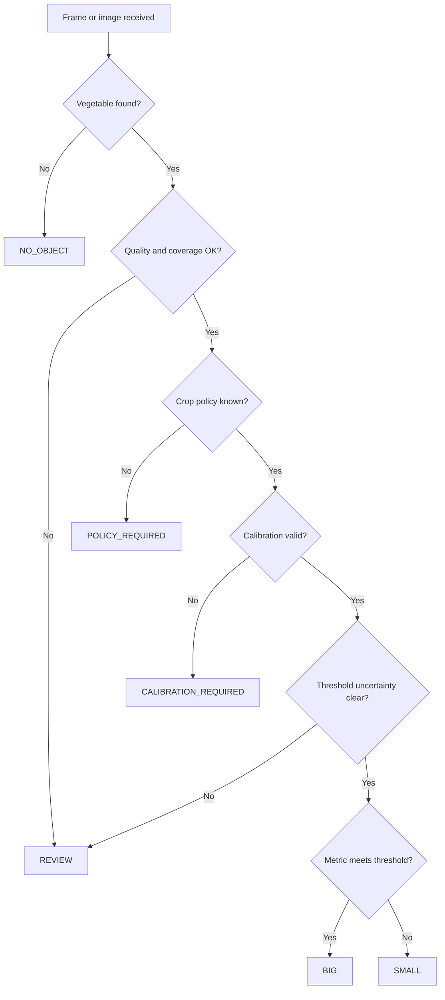
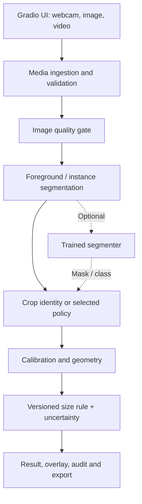

# Growize Vision: 48-Hour Vegetable Size Grading Assessment

Version: 1.0 — 22 October 2026  
Owner: Shoryakumar Mishra  
Context: AgResearch Labs (ARL) / Growize Farms — Vision & Autonomous Systems Associate assessment  
Status: Implementation specification; not a claim that software, datasets, experiments or tests have already been completed  
Primary evaluator requirement: classify a vegetable as `SMALL` or `BIG`  
Deadline: 48 hours from project kickoff; set an actual timestamp in `docs/PROJECT_LOG.md` before starting  
Supported interfaces: laptop webcam live, image upload, video upload; mobile camera as a conditional stretch target  
Document type: Combined PRD + SRS + ML design + data/annotation SOP + validation protocol + release gates + 48-hour execution plan + coding-agent master prompt

> Scope rule: The assessment passes or fails on credible, demonstrated `SMALL` versus `BIG` vegetable grading. Secondary features must never postpone, hide, or degrade that primary capability.

> Scientific truth rule: In an uncalibrated single image, pixel extent is not the same as physical size. The system must say whether a result is physically measured, calibrated under a controlled setup, or merely estimated from appearance. Unknown soil chemistry, yield, mass or disease cannot be reported as measurements from an ordinary RGB image.

---

## 0. Executive decision record

### 0.1 Frozen decisions

| ID | Decision | Why | Implementation consequence |
|---|---|---|---|
| D-01 | Primary product is binary size grading | Explicitly requested by evaluator | `SMALL` and `BIG` are the only valid *accepted grading classes* |
| D-02 | Output also has a separate operational status | Measurement can fail | `REVIEW`, `CALIBRATION_REQUIRED`, `NO_OBJECT`, `OUT_OF_SCOPE` are statuses, not a third size class |
| D-03 | Define crop-specific grading policies | A large coriander leaf and a large potato have different metrics | Versioned config, never one universal pixel threshold |
| D-04 | Calibrated geometry is primary evidence | Perspective/distance break uncalibrated size | Reference fiducial or known fixed plane required for physically meaningful measurements |
| D-05 | Controlled-camera/OpenCV baseline is the guaranteed MVP | Feasible without GPU or large training set | First complete end-to-end result before neural-model training |
| D-06 | Fine-tuned segmentation/classification is an enhancement | Can improve detection under imperfect backgrounds | Experiment must beat or complement baseline; do not block working baseline |
| D-07 | Dataset is assembled and annotated during the assessment | No dataset is supplied | Dataset manifest, physical measurements, annotation QA, specimen-group splits |
| D-08 | Laptop webcam, photo and video are mandatory | User requirement | All call one versioned inference core |
| D-09 | Mobile works via responsive browser / secure HTTPS if feasible | Depends on permissions, secure origin, network | Mobile upload required if accessible; live camera is a stretch and must be tested on an actual phone |
| D-10 | Extras are modular and disabled by default if unvalidated | Binary grader has absolute priority | Crop identity display, visual condition, knowledge cards, batch metrics can fail independently |
| D-11 | Acceptance numbers are targets, not achievements | No data or experiments have been run yet | Every metric shown only after reproducible evaluation |
| D-12 | No external paid API required | Reduce cost and failure risks | Local open-source stack, downloadable weights where license permits |

### 0.2 Four deliverable tiers

| Tier | Priority | Deliverables | 48-hour disposition |
|---|---|---|---|
| T0 — contractual core | P0 | Image → segmentation/measurement → `SMALL`/`BIG` when valid; calibration/error handling; documented crop policy | Must ship |
| T1 — input and evidence | P0 | Webcam live, video upload, image upload, per-frame/per-item overlays, reproducible benchmark, dataset manifest, annotated examples, README | Must ship |
| T2 — quality differentiators | P1 | Species label if supported, multi-object count, batch CSV and uncertainty/QA dashboard, model comparison, mobile upload | Ship only after P0 stable |
| T3 — research extensions | P2 | Visual defect flags, growth-history inputs, environmental data integrations, crop nutrition info, phone live streaming, edge export | Optional; never described as validated unless independently tested |

### 0.3 Definition of a valid grade

A size decision is *valid* only when all of these are true:

1. A vegetable instance was detected/segmented and is not critically occluded or truncated.
2. Its crop class and grading policy are known, or a crop policy was explicitly and visibly chosen by the operator.
3. Physical scale is trustworthy for the measurement plane or the output is labeled as `appearance_estimate` rather than a physical grade.
4. The crop-specific observable metric is appropriate and its threshold is traceable to an explicitly recorded assessment/demo rule.
5. Uncertainty interval does not make the threshold decision ambiguous, or the UI visibly declares the result as uncertain.
6. Image quality checks meet the grading policy's minimum requirements.
7. Source, policy version, model version and measurement method are recorded with the result.

If any mandatory condition fails, the system must not force a physically authoritative `SMALL`/`BIG` result. It should request a better view, calibration or manual review. For a binary-only grading API, a rejected frame is an error/status with no accepted size class; never smuggle `REVIEW` in as a third size category.

---

## 1. Background, users and physical workflow

ARL/Growize is building computer-vision and automation systems for farm operations and post-harvest inspection. The assessment's exact instruction is narrow—identify whether a vegetable is small or big—but a credible engineering approach should also explain how to transition from a laptop prototype to a controlled inspection station and, eventually, a machine-controlled sorter.

### 1.1 Personas

| Persona | Need | Acceptance observation |
|---|---|---|
| Evaluator / Nikhil | Simple reliable binary grading demo | Show small and big specimens and see sensible, repeatable output |
| Packing operator | Quickly sort crops without specialist knowledge | Clear overlay, per-item result, manual review warning, batch counts |
| ML engineer | Improve model across crops and lighting | Versioned datasets, per-crop metrics, failure gallery, reproducible experiments |
| R&D agronomist | Link observed appearance to crop information | Clearly distinguished measured data, operator inputs and reference information |
| Machine integration engineer | Receive deterministic events with safe behavior | Structured response, latency, bounded retries, unavailable/unsafe state |

### 1.2 Supported operating environments

| Environment | Camera geometry | Capability promise |
|---|---|---|
| Controlled station (preferred) | Camera approximately normal to matte tray; measured marker in same plane | Physical projected dimensions and grading within the validated field of view |
| Laptop webcam on a desk | Variable distance and perspective; user places printable marker beside produce | Conditional calibrated estimate with warnings for tilt/height |
| Uploaded single photo | Unknown origin and viewpoint | Calibrated grade *only* when sufficient fiducial/geometry information exists; otherwise appearance estimate or calibration request |
| Uploaded video | Moving camera, changing items, variable speed | Per-frame/object measurements on eligible frames; stable tracking and deduplication when reliable |
| Mobile browser | Device/HTTPS/browser dependent | Upload and photo capture first; continuous camera only if tested in a secure browser context |
| Real conveyor (future) | Camera, trigger and actuators, safety interlocks | Out of scope for final automation within 48 hours |

### 1.3 Scope boundaries

In scope:

- One image with one or multiple identifiable vegetables on a background.
- Configurable support for potatoes, onions, tomatoes, okra/ladyfinger, cucumbers and a *defined* leafy-vegetable unit (single leaf or bunch). Start with at least three or four physical crop groups if time/material is constrained; disclose exact completed coverage.
- Real-world size via marker or fixed rig with verified geometry; specimen-based evaluation.
- Frame inference, size labels, measurement text, overlay, CSV/JSON export.
- Out-of-distribution, poor image and uncertain condition handling.

Not in scope for the 48-hour verified release:

- Claiming universally perfect recognition for every vegetable on earth.
- Inferring kilograms, 3D volume, internal freshness, pesticides, microbe contamination, soil pH/NPK, irrigation history or actual farm yield from a normal image.
- Physically operating sorting motors, conveyor belts or drones without hardware validation and safety systems.
- Claiming certification or an official Agmark threshold when evaluator has supplied no standard.
- Interpreting every vegetation photograph as a harvestable single-item size measurement.

### 1.4 Ambiguities requiring explicit policy

Do not block implementation while waiting for answers. Instead use configurable provisional settings and mark them clearly.

| Ambiguity | Temporary engineering rule | Final production question |
|---|---|---|
| What is the cutoff for SMALL/BIG? | Per-crop versioned demo threshold measured from actual samples; no made-up official standards | Which physical property and cutoff does ARL use for each crop? |
| Does big mean mass, length, diameter or leaf maturity? | Length for elongated vegetables, diameter for round produce, defined leaf/bunch metric for greens | What criterion does sorting staff use? |
| How is a coriander/spinach bunch graded? | Treat one clearly isolated bunch as one object and grade a specified top-view metric, if calibrated | Per leaf, per plant, or per tied bundle? |
| Is misclassification cost symmetric? | Balanced evaluation with confusion matrices and explicit error costs | Which mistake causes more packing loss? |
| What crops are highest priority? | Potato, onion, okra, tomato; add green samples as available | Prioritize actual Growize product list |
| Available resources? | CPU-only viable; accelerated training optional | GPU/cloud allowance, exact laptop, camera, internet |
| Can physical specimens be sourced? | Purchase/borrow measured produce immediately | Site access and operator collection |

---

## 2. PRD — Product requirements

### 2.1 Product statement

`Growize Vision` is a local-first camera and media inspection application that segments vegetables, derives a configured size metric, and assigns accepted observations to one of two size classes, `SMALL` or `BIG`, while retaining enough evidence for an engineer to understand the decision and its limitations.

### 2.2 Product goals

- G-P1: Make primary grading inspectable rather than opaque: display segmented object, measured feature, threshold and source of calibration.
- G-P2: Work in three mandatory media paths using exactly the same grading engine.
- G-P3: Obtain defensible labels and held-out tests in 48 hours without dataset leakage.
- G-P4: Handle camera/lighting uncertainty without hallucinating measurements.
- G-P5: Show portability from prototype to a future fixed-camera rig.
- G-P6: Produce a clean, runnable assessment repository with a concise live demo and reliable fallback.

### 2.3 Non-goals and constraints

- No training result is accepted unless backed by a saved dataset split, command, logs, model artifact and validation output.
- An exact accuracy promise before tests is forbidden.
- Publicly sourced species images without rulers are useful for appearance/crop training; they are not ground truth for physical SMALL/BIG labels.
- The app should run offline after dependencies/weights are obtained; external weather/nutrition cards are strictly optional.
- No sensitive uploaded media is silently transmitted to a third-party inference endpoint.

### 2.4 Core stories and end-to-end acceptance

| Story ID | As a... | I want... | Acceptance |
|---|---|---|---|
| US-01 | Evaluator | Upload a potato image and grade it | Annotated image, valid `SMALL`/`BIG` or explicit calibration guidance, provenance shown |
| US-02 | Evaluator | Open webcam and hold a calibrated vegetable under it | Live overlay updates without app crashes and without uncontrolled queue backlog |
| US-03 | Evaluator | Upload a produce video | Progress, processed video or sampled contact sheet, per-item/frame CSV |
| US-04 | Evaluator | See why the category was assigned | Crop policy, actual metric/units, threshold, confidence/quality indication |
| US-05 | Operator | Detect several non-overlapping vegetables | Per-object results, tracked counts or frame counts clearly distinguished |
| US-06 | Operator | Receive safe handling of a poor image | No false certainty; clear status and retake instructions |
| US-07 | Engineer | Replace size policy without changing code | Versioned YAML configuration and repeatable tests |
| US-08 | Engineer | Train/retrain from curated images | Annotated manifest, split validation, reproducible command, metrics |
| US-09 | Engineer | Compare CV baseline to learned model | Same held-out evaluation, fair conditions, recorded latency |
| US-10 | Visitor | Open on a phone | Upload responsive at minimum; camera only if device/HTTPS tested |
| US-11 | Agronomy user | Read supplementary crop facts | Facts attributed to curated sources, separated from inferred attributes |
| US-12 | Operations reviewer | Audit a batch | Saved timestamp, camera/source, model/policy versions, per-item result export |

### 2.5 User experience screens

1. Inspect: large live/upload source area; crop-policy selector `Auto`/manual; calibrated/appearance indicator; result `SMALL` or `BIG`; object mask/bounding polygon; estimated length/diameter with units; retake reason.
2. Video / Batch: file size/duration preflight; progress bar; processed output; counts of accepted, review, not detected; CSV/JSON download; no double counting without verified tracking.
3. Calibration: marker print guide, actual marker size confirmation, corner detection overlay, warnings about object height and plane; camera profile management.
4. Dataset / Experiments (could be static report): samples per crop/grade/source, train/val/test distinct specimen counts, baseline-versus-model metrics, failures.
5. About the method: exact meaning of the labels, current validated crop list, caveats and no medical/agronomic measurement claims.

### 2.6 Non-negotiable interaction details

- Always show image/video provenance and processing status.
- Show units `mm`, `cm`, or `px` correctly; never display a pixel result under a millimeter label.
- Manual override must be visibly marked as operator-provided, never model-detected.
- When crop identity is unknown, ask for crop policy rather than arbitrarily choosing a threshold.
- Overlay must not hide the object or crop-critical defects; allow an original/annotated toggle.
- Include a legend explaining green/blue status and avoid red/green as the sole signal for color-blind users.
- Output files cannot retain an undisclosed prior user's image after a new session starts.
- UI should not display `99.9% confidence` if the classifier is not calibrated; model score and predictive reliability are different concepts.

---

## 3. SRS — Functional requirements with traceability

### 3.1 Ingestion and media

| Req ID | Priority | Requirement | Observable verification |
|---|---|---|---|
| FR-001 | P0 | Accept common valid JPEG/PNG/WebP images, subject to tested codec support | T-ING-01–05 |
| FR-002 | P0 | Provide browser webcam snapshots or continuous frame streaming | T-WEB-01–04 |
| FR-003 | P0 | Accept MP4 video; additional tested formats may be enabled | T-VID-01–08 |
| FR-004 | P0 | Enforce configured file-size, frame-resolution and duration limits | T-SEC-02 |
| FR-005 | P0 | Normalize EXIF orientation, colorspace, alpha handling, scaling and aspect ratio | T-ING-06–11 |
| FR-006 | P0 | Detect corrupt, empty, unsupported, malicious or oversized files | T-ING-12–16 |
| FR-007 | P1 | Support responsive mobile image upload | T-MOB-01–03 |
| FR-008 | P2 | Support live phone camera over HTTPS after device validation | T-MOB-04–07 |
| FR-009 | P0 | Allow user to stop webcam capture and video processing | T-WEB-05, T-VID-09 |
| FR-010 | P1 | Allow batch upload of multiple images, with bounded processing | T-BAT-01–03 |

### 3.2 Segmentation and object identity

| Req ID | Priority | Requirement | Observable verification |
|---|---|---|---|
| FR-011 | P0 | Segment at least one isolated vegetable from the calibrated mat | T-CV-01–06 |
| FR-012 | P0 | Report empty scene without inventing an object | T-CV-07 |
| FR-013 | P0 | Flag out-of-frame objects and excessive occlusion | T-CV-08–09 |
| FR-014 | P0 | Distinguish multiple non-overlapping instances where implemented | T-CV-10 |
| FR-015 | P0 | Exclude fiducials, tray rim, shadow blobs and packaging from vegetable mask | T-CV-11–14 |
| FR-016 | P1 | Predict one of the trained and supported crop identities, with open-set rejection | T-ML-06–10 |
| FR-017 | P0 | Permit explicit user-selected crop policy when identity model unavailable | T-POL-01 |
| FR-018 | P1 | Preserve per-object IDs in video where tracking is trustworthy | T-VID-10–12 |

### 3.3 Calibration and measurement

| Req ID | Priority | Requirement | Observable verification |
|---|---|---|---|
| FR-019 | P0 | Detect a known-size fiducial or load an independently verified fixed-rig transform | T-CAL-01–04 |
| FR-020 | P0 | Validate fiducial dictionary, ID, geometry, expected physical dimension and image position | T-CAL-05–08 |
| FR-021 | P0 | Correct perspective for a known common measurement plane when geometrically possible | T-CAL-09–11 |
| FR-022 | P0 | Compute physically named metric only with validated scale and plane assumptions | T-CAL-12–14 |
| FR-023 | P0 | Report `CALIBRATION_REQUIRED` instead of manufactured millimeters | T-CAL-15 |
| FR-024 | P0 | Record camera/marker/scale source and confidence/error budget | T-CAL-16 |
| FR-025 | P0 | Store measured length, width or equivalent diameter in correct units and expose mask area separately | T-MET-01–08 |
| FR-026 | P0 | Include a guard band around grading threshold | T-MET-09–12 |
| FR-027 | P1 | Validate size against caliper/ruler ground truth for new devices | T-MET-13–17 |
| FR-028 | P0 | For leafy produce, use an explicit `single_leaf`, `rosette` or `bunch` policy | T-LEAF-01–04 |

### 3.4 Grading and results

| Req ID | Priority | Requirement | Observable verification |
|---|---|---|---|
| FR-029 | P0 | For a valid accepted observation, output exactly `SMALL` or `BIG` | T-POL-02–03 |
| FR-030 | P0 | Apply configured crop-specific metric, threshold and comparison operator | T-POL-04–08 |
| FR-031 | P0 | Store `grading_policy_version`, `model_version` and `method` | T-AUD-01–02 |
| FR-032 | P0 | Return rejection/status reason separate from size class | T-POL-09–13 |
| FR-033 | P0 | Avoid grade flicker in live mode using stable-frame evidence or temporal smoothing | T-WEB-06–08 |
| FR-034 | P0 | No `BIG`/`SMALL` result on insufficiently exposed/blurred frames when quality gate fails | T-ROB-01–05 |
| FR-035 | P1 | Export per-item table with crop, metric, grade, confidence/status and source | T-OUT-01–03 |
| FR-036 | P1 | Export annotated still image or annotated sampled video | T-OUT-04–07 |
| FR-037 | P1 | Provide aggregation by crop and grade for a video or uploaded batch | T-BAT-04–08 |
| FR-038 | P0 | Clearly state appearance-only grade as uncalibrated estimate, if enabled | T-POL-14 |

### 3.5 Learning, reference content and operations

| Req ID | Priority | Requirement | Observable verification |
|---|---|---|---|
| FR-039 | P0 | Load training manifests with provenance and license metadata | T-DAT-01–04 |
| FR-040 | P0 | Ensure source-item/recording/lot group integrity across splits | T-DAT-05–09 |
| FR-041 | P0 | Train or reproducibly evaluate a documented baseline; log all model experiments | T-ML-01–05 |
| FR-042 | P0 | Produce per-crop and per-size confusion tables for supported crop categories | T-ML-11–16 |
| FR-043 | P0 | Never display unverifiable metrics, example labels or synthetic images as genuine test evidence | Manual audit |
| FR-044 | P1 | Display curated vegetable information separately from predictions | T-EXT-01–02 |
| FR-045 | P2 | Accept user-provided farm environment/soil telemetry or external observations with source/timestamp | T-EXT-03–05 |
| FR-046 | P2 | Produce agronomic advisory only as explicitly referenced, qualified general information | T-EXT-06 |
| FR-047 | P1 | Save a concise session log without unnecessary raw media/PII | T-AUD-03–06 |
| FR-048 | P0 | Provide an informative README, setup commands, demo workflow, model/data disclosures and limitation report | Manual audit |
| FR-049 | P0 | Operate if optional crop-identity model, knowledge API, or GPU backend is absent | T-FLT-01–04 |
| FR-050 | P0 | Fail safely on camera disconnect, codec failure, corrupt weights or low disk | T-FLT-05–09 |

### 3.6 Behavioral state machine

The grading engine has a decision state independent of the only two accepted size classes:



If the product explicitly offers an appearance-estimate branch, it must be opt-in, display `method=appearance_estimate`, and never be mixed into the physical-grade accuracy metric.

---

## 4. Measurement science and grading policy

### 4.1 Why classification of raw appearance is not sufficient

Perspective projection maps physical objects to different pixel sizes depending on focal length, distance, orientation and distortion. A model can learn background/camera correlations instead of object size. A 5 cm vegetable near the lens can look larger than a 15 cm vegetable far from it. Thus, no amount of image-only training establishes objective physical grading across arbitrary camera positions without calibration or additional depth information.

Three defensible pathways are:

1. `marker_homography`: known-size printed planar fiducial and target measured approximately in same plane; best portable assessment option.
2. `fixed_rig`: fixed camera pose, focal settings and tray plane, previously calibrated and verified; best future machine station option.
3. `rgbd_or_multiview`: depth/stereo or multiple calibrated views; future extension for true 3D geometry.

Each method has physical limitations. A single overhead plane transform describes the tray, not the top curved surface of a tall potato, so its silhouette still has parallax/height bias. Quantify this experimentally; do not promise precision beyond evidence.

### 4.2 Fiducial and station setup SOP

- Print a square ArUco marker or ChArUco board at 100% scale. Measure the black marker's intended physical side with a ruler/caliper after printing; enter the measured value, not only printer nominal size.
- Secure it flat to the tray. Place a matte contrasting background under produce. Keep the tray border and fiducial outside the object mask.
- Mount webcam overhead if possible. Turn off autofocus/autozoom where camera supports it. Record resolution, device ID and lens setting.
- When available, capture several diverse board views and estimate camera intrinsics/distortion; a simple single-marker plane transform is an MVP approximation, not a substitute for distortion calibration.
- Reject missing marker, partly clipped marker, tiny marker, unreasonably skewed geometry, implausible scale or poor reprojection quality.
- Calibrate again after moving the camera, changing camera zoom/resolution or changing tray height.
- Place measured reference objects of known 20, 50, 100 and 150 mm spans, where available, at several tray positions and compare recovered dimensions. Use a known rule/card only when its dimensions have been independently verified.
- When camera-to-vegetable height changes materially, record the observed bias, restrict operating zone or require a better rig.

Useful OpenCV basis: ArUco marker detection, camera calibration and ChArUco board routines. See official documentation in the research appendix.

### 4.3 Geometry implementation

For a validated planar homography `H` from image coordinates to tray coordinates:

1. Detect marker corners and solve the image-to-tray correspondence with robust geometric checks.
2. Undistort input if camera intrinsics are available.
3. Transform the vegetable contour/mask to the reference plane with physically defined resolution (e.g., 2 pixels per millimeter).
4. Remove small noise components using morphology tuned to object scale; avoid eroding narrow okra/leaf stems inappropriately.
5. Calculate the minimum-area rotated rectangle, major/minor axes, projected area and width profile.
6. Convert from the rectified physical coordinate grid to mm/cm; do not use bare original-image pixel thresholds.
7. Compare the policy metric against the configured limit with uncertainty guards.

For a simple fronto-parallel local approximation, `length_mm ≈ pixels_along_axis / pixels_per_mm`; this is valid only when the local scale is measured and the object-plane assumptions hold. A 2D projected area does not establish mass, volume or density.

### 4.4 Recommended crop-specific observables

| Crop/physical unit | Preferred demo observable | Why | Important limitation |
|---|---|---|---|
| Potato, isolated tuber | Projected long axis or equivalent top-view diameter, chosen in policy | Reproducible on mat | Not weight/3D volume; top-view bias for thickness |
| Onion, one bulb | Calibrated silhouette width/equivalent diameter | More meaningful than leaf/stalk | Bulb orientation and covering leaves |
| Tomato, one fruit | Calibrated projected diameter | Round produce | Perspective and 3D approximation |
| Okra/ladyfinger, one pod | Long-axis or skeleton length in mm | Elongated object | Bent pods need centerline length, not box diagonal |
| Cucumber, one fruit | Medial-axis arc length or calibrated long axis | Curvature | Strong curves and occlusion bias simple rectangle |
| Spinach/palak, single leaf | Leaf blade length or area; exclude petiole by policy | Definable leaf unit | Not equivalent to whole plant maturity |
| Coriander, single bunch | Calibrated bunch envelope width/area with defined packing procedure | Makes bunch unit explicit | High overlap; arbitrary loose foliage makes measurement unstable |

Policy per crop must contain: crop ID, physical unit definition, metric name, threshold, comparator (`>=` means BIG), threshold uncertainty band, version, source/evaluator approval, supported poses, confidence constraints and minimum coverage. `UNKNOWN` is an internal crop-ID status, not a grading class.

### 4.5 Threshold selection and leakage protection

The evaluator has not supplied ground-truth thresholds. There is no honest universal constant for all vegetables. Use this process:

1. Gather a representative small-to-large range for each crop. Physically measure samples with ruler/caliper before labeling.
2. Ask ARL for the actual buyer/packing policy when possible.
3. If no instruction is available, choose a clearly named `assessment_demo_v1` cutoff using a small *calibration/training* subset and record justification. These values are provisional and not official agricultural standards.
4. Freeze cutoffs before examining the final locked test set. Test labels must be assigned using physical measurements and the frozen policy, never adjusted to make the model look better.
5. Near-threshold samples must be deliberately included in evaluation and displayed with uncertainty. When measurement uncertainty straddles the cutoff, request review.

Example only, explicitly not a recommended real threshold: `if okra.length_mm >= policy.okra.threshold_mm: BIG else SMALL`. The number must come from evaluator or measured development data. Do not hardcode arbitrary figures as agronomic truth.

### 4.6 Measurement error budget

Record uncertainties from fiducial print measurement, corner localization, camera distortion, homography reprojection, shadow/segmentation boundary, object height above plane and angle. These contributions need not be statistically independent; a naive root-sum-of-squares may understate systematic bias. Prefer an experimentally measured calibration/measurement interval from known objects across positions and lighting conditions.

For threshold `T`, measured value `m` and conservative uncertainty `u`:

- If `m - u >= T`, accept `BIG`.
- If `m + u < T`, accept `SMALL`.
- Otherwise, `REVIEW` because the interval straddles the cutoff.

Keep an output field for `measurement_lower_mm`, `measurement_upper_mm`, and `uncertainty_method`, not a bare fabricated confidence percentage.

### 4.7 Color-based segmentation baseline

Initial controlled-mat algorithm:

1. RGB/EXIF/camera validation.
2. Resize with preserved aspect ratio; run blur/brightness/clipping checks.
3. Detect marker/ROI; mask marker and tray artifacts.
4. Estimate foreground against matte background using controlled luminance/chroma difference, HSV or CIELAB, with adaptive thresholds or background frame subtraction.
5. Apply morphology and connected components, with scale-aware kernel sizes.
6. Use contour geometry and shape filters; keep candidate masks and quality score.
7. Compute calibrated metrics using policy definition.
8. Produce grading result, mask overlay, machine-readable evidence.

Color thresholding is a controlled-station baseline, not a guarantee under arbitrary soil backgrounds or green-on-green foliage. Escalate to learned segmentation where this baseline fails.

---

## 5. Dataset acquisition, labeling and audit SOP

### 5.1 Principle: instances are not independent images

If a 10-second video of one potato yields 300 frames, it is still one physical potato. Splitting its frames into train and test yields a deceptively inflated result. Every captured frame must be associated with a unique `specimen_id`, `capture_session_id`, `device_id`, `lot_id` and `source_id`; where unknown, treat near-duplicates conservatively as the same group.

Public crop datasets almost never contain verified physical dimensions for each image. Use them for crop identity/segmentation pretraining and appearance diversity—not as physical size ground truth unless documented measurements exist.

### 5.2 Suggested achievable 48-hour dataset targets

These are planning targets, not promised collected results. Report completed counts transparently.

| Data tier | Target by deadline | Annotation type | Evaluation eligibility |
|---|---:|---|---|
| Physically measured produce | 60–100 distinct specimens across realistically available crops | Specimen ID, actual metric, crop, policy label | Primary physically valid size test |
| Images of measured specimens | 6–10 views/conditions each; 360–1,000 frames | Mask or audited polygon, crop, grouping, calibration | Training/validation/test, split by specimen |
| Licensed/attributed open public imagery | 600–1,200 distinct images if discoverable within time | Crop label, optional mask; license/source review | Crop identity or segmentation only, not metric size |
| Hard negatives / invalid captures | 100–200 media examples | Reason label: no object, occlusion, blur, no marker, clutter | Abstention and reliability checks |
| Audited segmentation masks | 300–600 high-quality masks, prioritized by crop/lighting | Full polygon/mask QA | Segmentation training and validation |
| Frozen physically measured test | At least 15–20 distinct specimens total, ideally 5+ per size class for each evaluated crop; higher counts needed for useful confidence | Ground truth before inference | Honest pilot test; insufficient for production claims |

An ambitious stretch is 1,500–2,500 provenance-tracked media records total. Do not equate raw count with unique specimens, complete polygon labels or validated physical size labels. If only 20 measured objects are available, prefer transparent credible evidence over 2,000 fabricated size labels.

### 5.3 Collection priorities and decision tree

Priority order:

1. Get physical specimens: potato, onion, tomato, okra from local stores/farm; spinach and coriander if available. A cheap ruler, matte surface and printed marker are higher priority than a fancy model.
2. Acquire genuine range of small and big specimens, especially near the provisional cutoff.
3. Record actual long axis/diameter/leaf measure, camera distance/angle, lighting and environment. Take a close-up of handwritten specimen code if it helps tracking.
4. Capture the same specimens with normal overhead, slight perspective, shadow, harsh side light, diffuse indoor light, cluttered background and phone if available.
5. Include zero-vegetable scenes, non-vegetable lookalikes, overlapping pairs and partly hidden objects as negative/review examples.
6. Add public images from AgML, individual original research datasets, Hugging Face dataset cards or academic repositories only after per-dataset permission/license checks. No blind image-search scraping and no undocumented train-test overlap.
7. If video is used to collect data, sample temporal neighbors sparsely and preserve the parent recording ID.

### 5.4 Dataset source ledger

Each source ledger row must contain:

`source_id`, `source_url`, `original_author`, `retrieval_date`, `license_name`, `license_url`, `commercial_permission_assessment`, `redistribution_permission`, `attribution_requirement`, `crop_scope`, `existing_annotation_type`, `physical_measurements_present`, `reliability_notes`, `download_sha256`, `files_count`, `status`.

Statuses: `APPROVED`, `RESEARCH_ONLY`, `LICENSE_UNCLEAR`, `REJECTED`. `LICENSE_UNCLEAR` never enters a distributable repo or training run intended for later ARL reuse.

### 5.5 Data schema — one instance per record

```json
{
  "sample_id": "ARL_20261022_S001_VIEW03",
  "image_sha256": "<real_sha256_at_ingestion>",
  "media_uri": "data/raw/local/session_01/S001_view03.jpg",
  "source_id": "self_capture_session_01",
  "source_license": "self_captured",
  "specimen_id": "S001",
  "lot_id": "shop_lot_A",
  "capture_session_id": "CS01",
  "device_id": "laptop_cam_A",
  "timestamp_utc": "<captured_timestamp>",
  "crop_id": "okra",
  "physical_unit": "single_pod",
  "physical_truth": {
    "metric": "centerline_length_mm",
    "value": null,
    "measurement_tool": "ruler",
    "uncertainty_mm": null,
    "measured_by": "<annotator_id>"
  },
  "grading_policy_id": "assessment_demo_v1",
  "size_label": null,
  "annotation": {
    "bbox_xyxy": null,
    "mask_uri": null,
    "mask_quality": "PENDING",
    "annotator_id": null,
    "reviewer_id": null
  },
  "camera": {
    "width_px": 1280,
    "height_px": 720,
    "calibration_profile": null,
    "fiducial_verified": false
  },
  "conditions": {
    "lighting": "indoor_diffuse",
    "background": "matte_light",
    "occlusion": "none",
    "blur": "none"
  },
  "split": "UNASSIGNED",
  "annotation_status": "PENDING"
}
```

Null means unknown; never populate measurements with guesses or ask an LLM to invent them.

### 5.6 Annotation ontology

Maintain separate label axes:

| Axis | Allowed examples | Who assigns | Used for |
|---|---|---|---|
| `crop_id` | potato, onion, tomato, okra, cucumber, spinach, coriander, `unknown` | Annotator, audited | Crop classifier / selection |
| `vegetable_mask` | Pixel or polygon mask | Human or semi-auto plus approval | Segmentation |
| `physical_unit` | tuber, bulb, fruit, pod, leaf, bunch | Annotator | Define what is measured |
| `size_label` | SMALL, BIG, null | Derived from measured truth + frozen policy | Grade evaluation |
| `grade_operational_status` | accepted, review, no_object, calibration_required, policy_required | Evaluation system | Reliability |
| `quality_observation` | clean_visible, visible_bruising, damaged_edge, unknown | Optional human evidence | Supplemental visual flags only |
| `annotation_quality` | verified, needs_fix, rejected | Independent reviewer | Training gate |

Object masks should include actual visible vegetable material, not surrounding box or shadows. For leaves, decide explicitly whether stems/petioles count. Occluded geometry should not be hallucinated as visible mask. Track rejected regions instead of deleting hard examples.

### 5.7 Annotation workflow

1. Import selected media into CVAT or equivalent local annotation app.
2. Define ontology exactly; prevent spelling aliases like `lady finger`, `okra` and `bhindi` from creating three model classes.
3. Auto-initialize polygons via classical contours or permitted segmentation-assisted tools; human checks all accepted annotation masks.
4. Correct polygon around actual silhouette, preserving holes/concavities when relevant.
5. Enter `specimen_id` and measured ground truth from external ledger; never infer length from the original pixel crop.
6. Assign `negative`, `partial`, `overlap`, `marker_missing`, `ungradable` for ambiguous media.
7. Export an archive and a lossless canonical COCO JSON or mask PNG; create YOLO-seg export only when needed.
8. Run script to detect missing label files, empty masks, out-of-range polygon coordinates, zero-area geometry, duplicate hashes, near-duplicates and malformed crop IDs.
9. Independent QA a stratified 15–20% of annotated examples and all proposed held-out test items; 100% test correctness is a gate.
10. Record disputes in `data/annotation_disagreements.csv` and freeze a resolution before test metrics.

CVAT supports instance masks/polygons and COCO and Ultralytics segmentation exports; it can reduce repetitive conversion work. Validate exported coordinates against source-image dimensions and spot-view several examples after export.

### 5.8 Quality acceptance for masks and ground truth

- Mask image aligns with exact source image hash and EXIF orientation.
- Every object identity and crop label has an accepted ontology value.
- Polygon does not include reference marker, human hands or cast shadow.
- Multiple separate vegetables have separate instance IDs where discernible.
- Every physical size label has a recorded real measurement, tool, policy and specimen ID.
- For difficult/occluded items, annotators may mark `UNGRADABLE` rather than invent invisible boundary.
- 100% of locked test size labels and physical measurements are verified by manual reviewer.
- Reject any public image labeled `BIG` solely because it fills much of the frame.

### 5.9 Train/validation/test protocol

- Split at `specimen_id`, never at individual frame. Also group by `source_family`/recording and preferably by capture session and acquisition lot.
- Target provisional 70/15/15 grouped split. When there are too few unique specimens, use a locked held-out specimen test and report confidence intervals and support counts rather than false precision.
- Apply augmentations only *after* split and only to training data. No augmented variants in validation/test.
- Keep train/test distribution by crop and both grades visible in a summary table; do not hide absent crop-grade combinations.
- Add a separate external-set evaluation for unseen camera/background/light/day where possible.
- Use a small development set for threshold/model tuning, then freeze final test. No repeated tuning on the locked test set.
- Run exact-hash and perceptual-near-duplicate checks across split boundaries; investigate collisions manually.
- If all capture data come from a single store/room/camera, report this domain limitation explicitly.

### 5.10 Dataset card requirements

Provide `docs/DATASET_CARD.md` covering target population, collection dates/sources, specimens/crops, label definitions, annotation tools, splits/groups, license and redistribution status, known class imbalance, expected bias, missing sensors, provenance/privacy, limitations and whether any samples are synthetic. Counts should be generated from manifests, not typed from memory.

---

## 6. ML and OpenCV modeling strategy

### 6.1 Experiment ladder — do in this order

| Experiment | Method | Inputs | Goal | Promotion rule |
|---|---|---|---|---|
| E0 | Hand-verified marker + manually curated mask | Calibrated still image | Validate geometry and crop policy independently of segmentation | Known-ruler test, correct threshold behavior |
| E1 | OpenCV marker + HSV/CIELAB/contour mask | Controlled mat | Guaranteed working demo baseline | Meets functionality and abstention tests |
| E2 | Classical geometric shape features with simple calibrated classifier | Mask + physical metrics | Compare learned decision to deterministic threshold | No inferior threshold-boundary reliability |
| E3 | Fine-tuned compact instance segmenter (e.g. YOLO26n-seg) | Annotated data | Expand to clutter/changeable backgrounds | Beats E1 on locked test without unacceptable latency/license risk |
| E4 | Crop identity classifier/head | Crop crop-outs with labeled species | Remove manual policy selection | Has measured per-class validation; otherwise use manual selector |
| E5 | Quality flagger / anomaly research | Additional curated visual labels | Show engineering breadth | Independent evidence; never gate core grade |

Important: YOLO COCO pretrained weights are not complete detectors for potato, onion, coriander or spinach. Do not advertise all-vegetable recognition from generic COCO weights. Either fine-tune with these exact classes, make crop selection manual, or report unsupported crop.

### 6.2 Algorithm ownership

- Deep learning does segmentation/object identity (and optionally crop recognition).
- Calibrated geometry does measurement.
- Versioned policy does SMALL/BIG thresholding.
- Quality/uncertainty gates decide whether the output can be accepted.

This decomposition is more testable than a monolithic CNN learning `SMALL/BIG` from uncontrolled photos. It also allows later ARL changes to grading rules without retraining every layer.

### 6.3 Model choice and licenses

First-choice experimental path: a tiny pretrained instance-segmentation checkpoint fine-tuned on audited vegetable masks, with small 640-pixel input, mixed precision only on supported GPU and early stop under a strict training budget. Compare against E1. Keep all exact package/model version hashes.

Ultralytics YOLO26 segmentation documentation explicitly supports custom training/validation; its code/models have AGPL-3.0 or Enterprise licensing. For a private commercial ARL product, legal/license review is mandatory. Using it in a research assessment does not automatically grant permission to deploy a proprietary commercial system. An alternative with compatible licensing or a licensed model may be needed for production.

Do not automatically download 8 GB checkpoints, install incompatible CUDA packages or waste hours compiling a robotics stack. CPU fallback must remain usable. Optional SAM-assisted annotation can be used only if available/license-compatible and if the human reviews every resulting mask.

### 6.4 Training recipe (conditional on data/hardware)

1. Freeze data taxonomy; select training implementation and permitted weights.
2. Export canonical masks to target model format, validate shapes, and visualize random annotated training samples.
3. Preflight hardware memory, GPU availability, model load and a 10-step smoke-training run.
4. Train with stratified crops and augmentation targeting exposure, mild blur/noise, white balance, rotations and backgrounds without altering physical truth or erasing fiducial when training calibration-dependent steps.
5. Disable augmentation leakage; log random seed, best checkpoint, environment, split hashes and entire training CLI.
6. Monitor train/val segmentation metrics, overfitting and per-crop failure cases. Stop when experiments no longer improve meaningful held-out indicators or consume critical demo time.
7. Evaluate E1 and E3 with the same held-out captures; make composite selection on grade accuracy, calibration validity, latency and abstention rather than segmentation mAP alone.
8. Preserve E1 as selectable fallback even if E3 wins.

### 6.5 Calibration, scores and abstention

Log raw model score separately from predictive correctness. Where enough independent validation samples exist, generate reliability plots and calibration statistics, e.g. expected calibration error or Brier score; with few specimens, describe uncertainty qualitatively and avoid claiming calibrated probabilities. An unknown crop/class or distribution shift triggers manual crop selection or review.

### 6.6 Evaluation dimensions and evidence

| Evaluation category | Metrics | How to interpret |
|---|---|---|
| Primary grade | Confusion matrix, precision/recall/F1 per class, balanced accuracy, macro-F1 | Only on truly measured, policy-derived labels |
| Operational safety | Accepted coverage, abstention rate, errors among accepted, false acceptance of invalid scenes | A reliable system may reject images |
| Geometry | Mean absolute error (mm), median error, P90/P95 absolute error, bias by tray location | Must be relative to ruler/caliper ground truth |
| Segmentation | IoU, Dice, per-crop mask score, tiny-object and overlap recall | A good mask isn't automatically an accurate grade |
| Identity | Per-crop confusion, unknown rejection, macro-F1 | Evaluated separately from grading |
| Robustness | Metric changes by lighting, angle, device, focus, background, shadows | No claim of universal coverage |
| Speed | Median/P95 end-to-end single-frame latency, FPS, video throughput, memory | Measure on the actual evaluator/demo laptop |
| Stability | Consecutive-frame grade flip count, dropped-frame count, crash rate | Monitor continuous operation |

Report confidence intervals (e.g. Wilson/bootstrapped by physical specimen) when possible, with the total *unique specimen count* shown adjacent to any percentage. If a per-crop test contains only 3 objects, describe results as anecdotal rather than reliable generalization.

### 6.7 Provisional 48-hour quality targets, not performance claims

| Target ID | Candidate gate | Caveat |
|---|---|---|
| QG-01 | 100% of synthetic/policy unit tests pass | This is software correctness, not model generalization |
| QG-02 | No wrong unit or fabricated physical measurement in invalid calibration cases | Safety gate; should be zero-tolerance |
| QG-03 | At least 90% acceptance of intentionally valid, controlled calibration images | Tune only on development set; report test acceptance separately |
| QG-04 | Pilot accepted-grade balanced accuracy goal >= 90% on independent measured specimens | Goal only; if not met, report actual and narrow supported domain |
| QG-05 | Physically projected measurement MAE <= 5 mm *if achievable* on controlled pilot objects | Must be measured; depends heavily on produce/rig |
| QG-06 | Video/photo/webcam runs with no unhandled exception in scripted smoke scenario | Test on target device |
| QG-07 | Median processed frame latency target <= 500 ms on demo laptop for controlled baseline | Tune according to measured laptop speed |
| QG-08 | At least 15 minute uninterrupted live session if resources allow | Operational stability demonstration |
| QG-09 | 100% final test labels traceable to a physical measurement or honestly marked nonphysical | Data integrity gate |

Do not edit these provisional numerical thresholds after looking at the final test outcomes just to mark the assessment "passed". Report a gate as failed/partial and keep functioning prototype honest.

---

## 7. Software architecture, interfaces and data flow

### 7.1 Logical architecture



The Gradio interface is deliberately thin. All paths call `InferenceService.inspect_frame(frame, context)` and do not reimplement preprocessing separately.

### 7.2 Modules and contracts

| Module | Input | Output | Failure behavior |
|---|---|---|---|
| `media` | uploaded bytes, camera frame or video file path | validated RGB frame and capture context | refuse invalid media, bounded error |
| `quality` | RGB frame | blur/exposure/glare/coverage flags | `REVIEW` and concrete retake reason |
| `calibration` | RGB frame and camera/marker config | homography or fixed-rig transform, error estimate | `CALIBRATION_REQUIRED` |
| `segmentation` | RGB frame, ROI, optional model | list of visible instance masks + confidence | no-object / model-unavailable fallback |
| `crop_id` | mask/crop and optional model or manual crop | normalized crop ID plus provenance | `POLICY_REQUIRED` |
| `measurement` | masks + transform + crop definition | dimensions, uncertainty and trace metadata | no physical result if invalid |
| `grading` | metric + policy + uncertainty | accepted `SMALL` / `BIG` or review status | deterministic threshold guard band |
| `tracking` | video detections | IDs, object transitions, stable grades | degrade to per-frame counts with disclosure |
| `rendering` | frame + objects | annotated image/frame | skip/retry without losing original result |
| `analytics` | accepted/reviewed item records | per-crop table, CSV/JSON, summary | never count duplicate frames as distinct objects |
| `reference_content` | normalized crop ID | static sourced crop information | unavailable without affecting grading |
| `telemetry` | structured event | local audit metrics | bounded and privacy-safe logging |

### 7.3 Recommended stack with fallback

| Layer | Preferred for assessment | Fallback / note |
|---|---|---|
| Python | Supported CPython version verified with local packages, pinned in lockfile | Do not use unsupported preview Python |
| Computer vision | `opencv-python` or appropriate headless build; NumPy, Pillow | Avoid duplicate GUI/headless OpenCV conflicts |
| Interface | Gradio Blocks, official Image/Video sources | Plain Streamlit only if Gradio webcam impossible in environment |
| ML | PyTorch + fine-tuned compact segmenter if GPU/time permit | OpenCV contour segmentation; no dependency on ML checkpoint for core demo |
| Annotation | CVAT polygons/masks or verified local alternatives | Manual polygon mask tool plus manifest |
| Dataset metadata | CSV/JSONL + YAML data card + SHA-256 | SQLite optional for concurrent capture |
| Training tracking | CSV/JSON logs + plots; MLflow optional | No MLflow server as critical dependency |
| Batch video | OpenCV VideoCapture/VideoWriter; optional FFmpeg | Preserve original; process bounded samples if decode performance poor |
| Tests | `pytest`, fixtures, property tests for geometry | No untested production paths |
| Lint/type | Ruff, typing/mypy/pyright if feasible | No lint pass claim without execution |
| Reproducibility | `pyproject.toml`, lock or pinned requirements, scripts | Docker optional, not blocker on laptop |

Gradio documents browser webcam still/stream inputs and video upload/webcam recording. The phone can open a hosted app via a reachable network address, but mobile webcam APIs generally need HTTPS and explicit permission. A laptop's `localhost` is not a phone's `localhost`; opening `http://192.168.x.x` on the phone may display the UI while browser camera capture is blocked. Build and test phone upload first; add properly secured HTTPS tunneling only if permitted and time remains.

### 7.4 Suggested repository layout

```text
growize-vision/
├── README.md
├── pyproject.toml
├── requirements.lock                # or reproducible pinned equivalent
├── LICENSE-NOTICES.md               # all runtime, weights, datasets
├── .gitignore
├── .env.example                     # no real secrets
├── config/
│   ├── grading_policies.yaml
│   ├── cameras.yaml
│   ├── inference.yaml
│   └── crop_ontology.yaml
├── src/growize_vision/
│   ├── __init__.py
│   ├── domain.py
│   ├── config.py
│   ├── media.py
│   ├── image_quality.py
│   ├── marker.py
│   ├── segmentation_cv.py
│   ├── segmentation_model.py
│   ├── crop_identity.py
│   ├── measurement.py
│   ├── grading.py
│   ├── tracking.py
│   ├── batch.py
│   ├── inference.py
│   ├── rendering.py
│   ├── export.py
│   ├── crop_facts.py
│   └── audit.py
├── apps/
│   └── gradio_app.py
├── scripts/
│   ├── create_marker.py
│   ├── collect_dataset.py
│   ├── validate_manifest.py
│   ├── create_group_split.py
│   ├── export_annotations.py
│   ├── train_segmenter.py
│   ├── evaluate_baseline.py
│   ├── evaluate_model.py
│   ├── benchmark_latency.py
│   ├── generate_failure_gallery.py
│   └── run_demo_preflight.py
├── data/
│   ├── raw/                         # never overwrite originals
│   ├── annotations/
│   ├── processed/
│   ├── manifests/
│   └── splits/
├── models/
│   ├── README.md                    # weights/provenance/URLs
│   └── checksums.json
├── tests/
│   ├── fixtures/
│   ├── test_domain.py
│   ├── test_media.py
│   ├── test_marker.py
│   ├── test_measurement.py
│   ├── test_grading.py
│   ├── test_segmentation.py
│   ├── test_video.py
│   ├── test_manifest.py
│   ├── test_pipeline_integration.py
│   ├── test_failure_modes.py
│   └── test_security.py
├── reports/
│   ├── experiments/
│   ├── metrics/
│   ├── examples/
│   ├── failure_gallery/
│   └── DEMO_REPORT.md
├── docs/
│   ├── ASSESSMENT_SPEC.md
│   ├── PRD.md
│   ├── SRS.md
│   ├── DATASET_CARD.md
│   ├── MODEL_CARD.md
│   ├── ANNOTATION_GUIDE.md
│   ├── CALIBRATION.md
│   ├── VALIDATION_PLAN.md
│   ├── KNOWN_LIMITATIONS.md
│   ├── PROJECT_LOG.md
│   └── FUTURE_ROBOTICS.md
└── artifacts/
    ├── sample_inputs/
    ├── annotated_outputs/
    └── demo_video.mp4
```

Use Git LFS or release artifact storage for large weights/videos if licensing permits. Do not dump hundreds of MB of image data into normal Git history. Never commit secret tokens, personal photo folders or unlicensed datasets.

### 7.5 Data contracts — grading policy example

The placeholder below is intentionally not executable until the real threshold is inserted. This protects the project from quietly inventing standards.

```yaml
schema_version: 1
policy_id: assessment_demo_v1
status: provisional_until_approved
units: mm
per_crop:
  okra:
    display_name: Ladyfinger / Okra
    physical_unit: single_pod
    size_metric: centerline_length_mm
    threshold_mm: null             # required: set after measured calibration samples
    big_if: greater_than_or_equal
    guard_band_mm: null            # required: based on measurement validation
    require_calibration: true
    minimum_visible_fraction: 0.95  # implementation policy target, not an observed accuracy
    accepted_method: [marker_homography, fixed_rig]
  potato:
    display_name: Potato
    physical_unit: single_tuber
    size_metric: projected_major_axis_mm
    threshold_mm: null
    big_if: greater_than_or_equal
    guard_band_mm: null
    require_calibration: true
    accepted_method: [marker_homography, fixed_rig]
  spinach:
    display_name: Palak / Spinach
    physical_unit: single_leaf
    size_metric: blade_length_mm
    threshold_mm: null
    big_if: greater_than_or_equal
    guard_band_mm: null
    require_calibration: true
    accepted_method: [marker_homography, fixed_rig]
```

Configuration validator behavior: a null threshold must make that crop `POLICY_REQUIRED`; it must never default to zero, a string or an arbitrary global threshold. Configurations that specify contradictory crop metric/unit combinations should fail fast with clear diagnostics.

### 7.6 Structured result contract

```json
{
  "schema_version": "1.0",
  "request_id": "<uuid>",
  "timestamp_utc": "<iso8601>",
  "source_type": "webcam|image|video",
  "policy_version": "assessment_demo_v1",
  "software_version": "<git_sha>",
  "model_version": "opencv_baseline_v1",
  "frame_id": "<frame_or_image_id>",
  "status": "ACCEPTED",
  "objects": [
    {
      "object_id": "obj_0001",
      "crop_id": "okra",
      "crop_origin": "operator_selected",
      "crop_score_raw": null,
      "size_class": "BIG",
      "grading_status": "ACCEPTED",
      "measurement": {
        "metric": "centerline_length_mm",
        "value_mm": 112.4,
        "lower_mm": 108.0,
        "upper_mm": 116.8,
        "method": "marker_homography",
        "calibration_id": "calib_devA_01"
      },
      "threshold_mm": 100.0,
      "mask_uri": "<session_relative_mask_path>",
      "warnings": []
    }
  ],
  "elapsed_ms": null,
  "warnings": []
}
```

The numbers `112.4`, `108.0`, `116.8`, and `100.0` above are purely illustrative contract fixtures; they are not measurements or recommended real grading policy cutoffs. Tests may use them as synthetic deterministic examples only. When status is not accepted, `size_class` must be `null` and an `error_code`/retake message must be included.

### 7.7 API behavior if a backend is implemented

No separate API is required for a 48-hour Gradio demonstration; keep `InferenceService` reusable so FastAPI/robotics adaptation is straightforward. If API is added:

| Route | Method | Purpose | Success/failure |
|---|---|---|---|
| `/healthz` | GET | Process and dependencies alive | 200 lightweight |
| `/readyz` | GET | Required model/config ready | 200 / 503 |
| `/v1/inspect/image` | POST | One uploaded image | 200 valid JSON or 4xx validation error |
| `/v1/inspect/video` | POST | Video batch task | bounded synchronous job or 202 with polling |
| `/v1/policies` | GET | Current policies and supported crops | display version, provenance |
| `/v1/metrics` | GET (local/admin) | Aggregate operational telemetry | no unconsented raw media |

Never add authentication-free cloud upload endpoints casually. The app may bind to localhost for the laptop; a phone-accessible server has new exposure and should use a deliberate network/security mode.

### 7.8 Video strategy

- Open video with explicit cap on duration, byte size, decoded resolution and total processed frames.
- Record original duration/FPS/frame count if decodable; guard zero/NaN FPS.
- Sample frames by time interval, not by assuming every video is exactly 30 FPS; preserve timestamps.
- Process each sample with same `inspect_frame` service and known video context.
- Only count distinct vegetables if stable tracking/line-crossing is validated. Otherwise label output `detections per sampled frame`, not `individual vegetables sorted`.
- Temporal smoothing on tracked IDs may reduce flicker but should never hide near-threshold uncertainty.
- Save annotated MP4 with reliable codec and verified playback, and CSV with `timestamp_s`, `frame_id`, `track_id`, grade/status, crop, metric and caveats.
- On long videos provide graceful partial report with explicit `incomplete` flag; never silently truncate.

### 7.9 Live webcam strategy

- Use `gr.Image(sources=["webcam"], streaming=True)` and streaming callback, or an equivalent supported Gradio pattern verified against the pinned installed version.
- Bound callback concurrency to one active inference per camera stream, discard stale frames rather than building multi-second backlog.
- Set target processing rate according to observed hardware; skip frames when overloaded.
- Show rolling latency, last accepted frame time and whether camera permission/stream is active.
- Require 3–5 consistent eligible frames for stable UI presentation if temporal smoothing implemented; count frame-only performance separately.
- Handle camera unplug/permission revoke and tab hide without crash or continuous sensitive camera capture.

### 7.10 Mobile strategy

P0: responsive browser page can accept image/video files created by a phone camera.  
P2: browser live camera only after serving via trusted HTTPS/secure origin and testing front/back camera on actual Android/iOS device.  
Alternative: user films a clip with phone and uploads it—this still satisfies media ingestion without live browser camera integration.

Do not expose a local laptop to the public internet via an unreviewed tunnel or automatically generate public sharing links. Use an approved secure route or demonstrate mobile via same-device local development with a valid secure origin.

---

## 8. Nonfunctional requirements (NFRs)

| NFR ID | Requirement | Gate / verification |
|---|---|---|
| NFR-001 | Correct units, threshold boundary and no invented physical values | Mandatory unit/property tests |
| NFR-002 | End-to-end image run reproducible from clean install | Fresh environment smoke |
| NFR-003 | All mandatory input methods use a single inference service | Code inspection + cross-input golden case |
| NFR-004 | Median latency target <= 500 ms for OpenCV baseline on actual laptop | Benchmarked; disclose if exceeded |
| NFR-005 | No unbounded memory growth over long running camera session | 15-min profiling where possible |
| NFR-006 | Every accepted physical grade has calibration/policy trace | Audit assertion |
| NFR-007 | Offline inference after weights/dependencies available | Disconnect network smoke |
| NFR-008 | No external upload of media without informed consent | Network/config audit |
| NFR-009 | Video input storage bounded by file size/duration and temporary cleanup | Malicious-media tests |
| NFR-010 | Error copy identifies camera/marker/lighting remedy | UX manual review |
| NFR-011 | Dataset/model usage complies with identified licenses | Legal/notice checklist |
| NFR-012 | Application has no hardcoded absolute developer workstation paths | Clean clone run |
| NFR-013 | Tested on evaluator laptop OS/browser and webcam | Recorded compatibility matrix |
| NFR-014 | Data deletion/retention rule clear; output path constrained | File safety tests |
| NFR-015 | Inferences are deterministic for fixed model/config/seed where algorithms permit | Golden deterministic test |
| NFR-016 | Logs can reproduce policy/model/runtime version | Manifest metadata assertion |
| NFR-017 | UI accessible by keyboard and visually legible in default viewport | Manual accessibility pass |
| NFR-018 | Model not loaded globally more than once per worker | Instrumentation/memory test |
| NFR-019 | Unvalidated crop categories are visibly unavailable or review-only | Unsupported crop test |
| NFR-020 | Software never actuates hardware in the assessment | Integration boundary audit |

### 8.1 Operating-system and dependency preflight

Record:

- OS, CPU, RAM, GPU model and available VRAM, Python version, `pip` version, webcam resolution, local storage.
- Camera accessibility by browser; browsers and permissions.
- Installed OpenCV variant and `cv2.aruco` feature/API availability.
- Video decoder/encoder availability; actual MP4 round-trip read/write.
- PyTorch CUDA/MPS/CPU backend availability; command lines used to verify.
- Storage free space prior to video processing and dataset extraction.
- Package hashes and locked dependency versions.

Run this preflight before dataset downloads or training. Do not accidentally spend most of the 48 hours debugging CUDA on a machine without a supported GPU.

### 8.2 Security, privacy and legal controls

1. Local development server binds `127.0.0.1` unless mobile/network access is deliberate.
2. Reject paths outside managed upload/result directories; never trust a client-supplied output filename.
3. Sanitize names; strip image metadata where not needed; avoid logging faces/backgrounds or other incidental personal details.
4. Configure upload caps, video frame caps, processing timeouts and cleanup of temporary files.
5. Do not enable arbitrary remote URL fetching/SSRF through a user input field.
6. Do not load untrusted `pickle` or model checkpoints from arbitrary user-supplied URLs; verify source and checksum.
7. Avoid committing paid API tokens, GitHub tokens or cloud keys; populate `.env.example` with placeholders only.
8. Keep commercial licensing status for model, code and each dataset separate; license of one tool does not automatically cover datasets or weights.
9. No private ARL farm imagery should enter public GitHub without explicit authority.
10. Be explicit about data retention and one-click session cleanup when feasible.

### 8.3 Accessibility and trust presentation

Use text labels and symbols in addition to colors. Show detection status independently of grade. If crop selection is manual, include `selected by operator`. If measurements are approximate, say `projected size estimate`. Show clearly why an image is rejected (`marker not visible`, `vegetable partly outside image`, `too blurred`, `crop policy missing`).

---

## 9. Master verification plan and test catalog

### 9.1 Test levels and reporting evidence

Every test result must include test ID, command or manual steps, input fixture/source, expected outcome, actual outcome, environment, timestamp, run status `PASS|FAIL|SKIPPED|BLOCKED`, and artifact path or screenshot. Mark a test `SKIPPED` when platform/device unavailable, never `PASS`.

Test levels:

1. Unit: pure geometry, grading, config, conversions, validation, no camera required.
2. Integration: media decoding + pipeline + exporter and model fallback.
3. Dataset integrity: annotation/provenance/split reproducibility.
4. ML evaluation: frozen test, grouped metrics, uncertainty, failure gallery.
5. Device/E2E: webcam, video, mobile as available, runtime and permissions.
6. Adversarial: unknown crops, misleading backgrounds, corrupted uploads, no marker, bad lighting.
7. Usability: evaluator can find input and understand reason/grade in 15 seconds.

### 9.2 Exact required test scenarios

| IDs | Scenario | Required assertion |
|---|---|---|
| T-ING-01–05 | JPEG/PNG/WebP supported files, high-resolution image, grayscale handling, empty image | Valid decode or informative refusal without crash |
| T-ING-06–11 | EXIF rotation, RGB/BGR conversion, transparent PNG, mirrored webcam, aspect ratio, weird ICC | Consistent shape/geometry; explicit conversion |
| T-ING-12–16 | Corrupt bytes, zero-byte file, unsupported TIFF/HEIC if codec absent, decompression bomb, oversized file | Bounded 4xx/validation message; never hang |
| T-WEB-01–05 | Permission granted/denied, absent camera, disconnect, stop, multi-session switching | Correct live/stop state; no leakage or exception |
| T-WEB-06–08 | Slight hand motion, grade threshold proximity, slow inference | Stable display or review, no exploding queue |
| T-VID-01–09 | 10 s, 60 s, variable FPS, no audio, rotated video, odd dimensions, missing frame count, corrupt codec, cancel | Bounded processing and truthful progress/status |
| T-VID-10–12 | Moving one object, objects crossing, duplicate frames | Distinct tracking or clear per-frame-only reporting |
| T-MOB-01–07 | Portrait upload, rotated photo, phone video, HTTPS access, camera permission, front/back lens, network loss | Correct mobile result; live failures clearly reported |
| T-CV-01–06 | Isolated round/elongated/leafy foreground, dark/light tray, multiple blobs, small object | Correct masks where supported; unsupported → review |
| T-CV-07–14 | Empty mat, clipped produce, occlusion, two objects, marker false mask, cast shadow, gloves/hand, wrapper | No confident false size on ineligible region |
| T-CAL-01–04 | Correct marker scale, marker perspective, fixed-rig profile, known rectangular ruler fixture | Physically correct local transform within tested tolerance |
| T-CAL-05–08 | Wrong ArUco ID, wrong marker size, partly visible marker, impossible shape | Calibration rejected, explanation included |
| T-CAL-09–11 | Rotation/perspective, lens warp fixture, corner order permutation | Known geometry recovered or safely rejected |
| T-CAL-12–16 | Object no marker, policy requiring metric, unknown camera, passing uncertainty source | Never invent mm; record calibration trace |
| T-MET-01–08 | Circle/rectangle/ellipse synthetic masks, bent pod, narrow blade, split mask, units, zero area | Expected geometry and unit conversion |
| T-MET-09–12 | Exactly threshold, just below, uncertainty overlaps, above with margin | Deterministic accepted result / review |
| T-MET-13–17 | Measured ruler samples at center/corners, varied distance, different camera, produce thickness | Measured error and limits recorded |
| T-LEAF-01–04 | One leaf, two overlapping leaves, one bunch, stray stems | Per-policy behavior, ambiguity flagged |
| T-POL-01–14 | Manual policy, binary enum, wrong crop, changed threshold config, null threshold, unknown crop, appearance mode | Versioned and correct, no third accepted class |
| T-ML-01–05 | Training setup, checkpoint load, set seeds, training smoke, reproducible eval | Reproducible manifest, clear skipped GPU |
| T-ML-06–10 | In-scope species, unknown fruit, leaf lookalike, background-only, confidence below gate | Correct supported class/reject; score not invented |
| T-ML-11–16 | Per-crop size confusion, balanced metrics, intervals, group bootstrap, false acceptance, insufficient support | Full metrics plus specimen counts |
| T-DAT-01–09 | Missing source, invalid license, duplicate sample hash, missing mask, train-test specimen leakage, original/augmented collision | Dataset validator rejects bad dataset |
| T-BAT-01–08 | Many images, batch metadata, duplicate filenames, export counts, no tracking, partial failure | Correct row count, explicit unit of count |
| T-OUT-01–07 | CSV schema, JSON schema, Unicode crop name, overlay, playable MP4, original unchanged, safe filenames | Correct artifacts, no accidental overwrites |
| T-ROB-01–05 | Low lux, severe glare, image shake, partial frame, backlight | Fail gracefully, retake suggestions |
| T-FLT-01–09 | Missing weight, missing optional package, no internet, corrupt config, camera disconnect, full disk, video codec unavailable | Controlled recovery, no false acceptance |
| T-SEC-01–08 | Path traversal, huge image header, giant video, strange filenames, file extension spoofing, malformed JSON, directory exposure, model path injection | Refusal or safe handling |
| T-AUD-01–06 | Version fields, source hashing, no secret/PII logs, session isolation, delete/retention behavior | Audit integrity and privacy |
| T-EXT-01–06 | Crop facts missing, outdated/unattributed data, no internet, manually entered soil values, external timestamp | Proper source/unknown distinction |

### 9.3 Critical property-based and golden tests

These tests should be implemented even if no model training occurs:

1. `m - u >= T → BIG`, `m + u < T → SMALL`, otherwise `REVIEW`, across randomized synthetic `m`, `u`, `T` within valid numeric ranges.
2. Nonfinite metric/uncertainty (`NaN`, `inf`), negative scale or zero-area masks can never become accepted grades.
3. Changing input resolution with geometrically matched scale preserves grade within numeric tolerance.
4. Translating a rigid mask without scaling preserves geometric dimensions.
5. Rotating an isolated rectangular mask preserves major/minor axes within rasterization tolerance.
6. Changing physical marker size while holding the same pixel marker changes recovered physical dimensions predictably; wrong configured marker ID is rejected.
7. Multi-object order and filename order must not change per-object grade.
8. Invalid crop policies (`threshold=null`, `guard_band<0`, unsupported metric) are rejected.
9. All displayed units must derive from the measurement's unit enum, not UI text constants.
10. Input image buffer remains unchanged by inference; rendering creates a copy.
11. Threshold and model versions appear on every exported record.
12. Switching between image/video/webcam for the same still frame yields identical core result within defined numerical tolerance.
13. An upload containing just a marker, ruler or blank mat never yields a vegetable `SMALL`/`BIG`.
14. An object touching frame boundary triggers incomplete measurement unless validated crop-specific logic explicitly permits it.

### 9.4 Physical validation protocol

For each supported crop where ground truth exists:

1. Assign specimen ID and manually measure relevant physical dimension at least twice; record observer and disagreement.
2. Define policy before the specimen enters final test.
3. Capture minimum two lighting conditions and two positions/angles if time permits.
4. For every image, compute measurement and accepted/review status, then compare with truth.
5. Group results by physical specimen; average repeated views only for a declared specimen-level metric.
6. Report center-vs-corner bias, angle bias, lighting degradation and near-threshold confusion separately.
7. Include images of every critical failure in a gallery with explanation and proposed mitigation.
8. Redo camera calibration if measurement bias violates the accepted operating envelope; rerun locked assessment as a *new* evaluation round, not a covert changed result.

Example output table, to fill after testing:

| Crop | Unique specimens | Accepted decisions | Actual SMALL | Actual BIG | Balanced accuracy | MAE mm | Rejected | Notes |
|---|---:|---:|---:|---:|---:|---:|---:|---|
| Potato | TBD | TBD | TBD | TBD | TBD | TBD | TBD | No fabricated numbers |
| Onion | TBD | TBD | TBD | TBD | TBD | TBD | TBD | — |
| Okra | TBD | TBD | TBD | TBD | TBD | TBD | TBD | — |
| Tomato | TBD | TBD | TBD | TBD | TBD | TBD | TBD | — |
| Leafy specimen | TBD | TBD | TBD | TBD | TBD | TBD | TBD | Specify physical unit |

### 9.5 Robustness stress grid

Test at least one small and one big physically measured specimen through applicable combinations. The full Cartesian product may be infeasible in 48 hours; cover pairwise combinations and disclose gaps.

| Dimension | Easy condition | Difficult condition | Expected behavior |
|---|---|---|---|
| Lighting | diffuse indoor | dim, backlit, overhead glare | Correct where valid, otherwise quality/review |
| Background | matte uniform | soil/foliage/tiles/printed texture | Robust model or explicit unsupported notice |
| Angle | overhead | oblique / topography distortion | Geometry validated or calibration rejected |
| Distance | fixed rig | handheld near/far | Scale recomputed or rejected |
| Focus | sharp | motion blur / defocus | blur warning |
| Occlusion | isolated | partly covered by hand/other produce | review when physical extent unavailable |
| Crop size | far from threshold | within uncertainty band | no forced high confidence |
| Input | still | video variable FPS / camera | same semantic grade where frame eligible |
| Species | trained crop | unknown/ornamental/fruit lookalike | policy required / unsupported |
| Color | ordinary green/red/brown | bruised, dusty, washed, wet | segmentation check, not false grade |
| Marker | clear correct | absent, rotated, clipped, changed print size | rejection when invalid |
| Device | laptop | phone wide-angle lens | new calibration or appearance-only |

### 9.6 Non-obvious red-team cases

- Hold the same small potato at 10 cm and 50 cm from the lens. Raw pixel size changes; the calibrated system must not flip merely from distance without reporting invalid geometry.
- Show a small potato beside a much bigger onion. Global object area must not be used as the crop-specific physical label.
- Put a black glove or folded paper on the mat. It must not be confidently segmented as produce.
- Cover the ArUco marker and keep the vegetable visible. No result in `mm` should be accepted.
- Put two okra pods touching: merged contour should not be presented as one gigantic pod.
- Rotate a bent okra; rectangular diagonal is not true centerline length.
- Photograph loose coriander scattered on a counter. A valid bunch policy should not silently grade arbitrary leaves as one vegetable.
- Upload mirrored/EXIF-rotated photo with marker: measurement must not invert or mis-scale.
- Change declared marker side length from actual measured value; validator should catch improbable scale or test must document vulnerability.
- Feed same measured specimen repeatedly from a video, then verify summary does not count hundreds of distinct crops.
- Request an unknown crop. Manual policy selection may be allowed, but it must be displayed.
- Feed adversarial low brightness, color cast and motion blur until detection becomes unreliable; judge abstention behavior, not only accepted-frame accuracy.

---

## 10. Quantitative gates and release stop conditions

These gates are ordered. Later gates may not compensate for failure of an earlier hard gate.

| Gate | Must demonstrate | Hard fail condition | Evidence artifact |
|---|---|---|---|
| Gate 0 — Scope | Core remains binary size grading; provisional crop policies documented | Extras obscure/misstate main assignment | `docs/ASSESSMENT_SPEC.md` |
| Gate 1 — Environment | Clean startup and camera/video dependencies tested | Cannot launch on target laptop | Preflight log |
| Gate 2 — Data integrity | Original files protected; provenance/license known; real size truth distinct from public images | Fabricated dimensions, leak across splits, unknown distribution rights | Manifest validator + data card |
| Gate 3 — Calibration truth | Known-length reference tests, wrong/missing marker rejection | Pixel length displayed as unqualified physical length | Calibration test report |
| Gate 4 — Inference end-to-end | Valid image → mask → measure → binary grade; invalid → explicit review | Random/untraceable `SMALL`/`BIG`; crash | Demo images + logs |
| Gate 5 — Input coverage | Webcam, image and video tested on laptop | Any mandatory interface wholly broken | E2E screenshots/video/manifest |
| Gate 6 — Frozen evaluation | Test groups independent; per-crop confusion and rejected cases | Training/test contamination, cherry-picked sole example | Evaluation JSON/CSV, failure gallery |
| Gate 7 — Reliability | Critical invalid inputs rejected, no silent corruption | Unsafe false grades on known invalid physical cases | Automated test log |
| Gate 8 — Packaging | README, exact versions, run/test command, model/data credits, known limitations | Reviewer cannot start or interpret system | Fresh-start capture |
| Gate 9 — Final demo | Rehearsed 3-minute path plus fallback | Demo depends on an unrecoverable cloud/GPU component | Recorded rehearsal and offline backup |

### 10.1 Release states

- `GREEN`: Gates 0–9 satisfied; measured test results and supported crops explicitly reported.
- `YELLOW`: Functional calibrated pilot with a limited crop set or insufficient unique test specimens; submit honestly as research prototype with clear limitations.
- `RED`: No reproducible accepted binary grading, misrepresented physical size, dataset/test leakage, or unsupported live claims. Do not describe as reliable deployment.

### 10.2 Promotion hierarchy

When E3 trained model is worse on held-out data, prefer E1 baseline in the final demo and present E3 as a research experiment. When the controlled-station baseline cannot grade in clutter, show its operating boundary and any learned-segmentation improvement separately. A more complicated architecture is not evidence of better system performance.

---

## 11. 48-hour critical-path execution timetable

The clock starts when implementation starts. Cutoffs below are strict triage gates; adapt to available hardware but preserve the sequence. Tasks can overlap only after their dependencies have stable interfaces.

| Elapsed time | Work package | Must be produced | Stop/decision gate |
|---|---|---|---|
| H00–H02 | Repo and device preflight, Gradio scaffold, OpenCV/ArUco smoke, determine threshold policy | `README` boot command, working webcam/image UI, repo/log | If GPU unavailable, declare CPU path immediately |
| H02–H04 | Physical collection setup, marker printing and measured size-policy shortlist | Marker, actual mm measurement, initial 12+ specimen IDs, policy YAML placeholders | No physical ruler/marker → urgently source or disclose metric limitation |
| H04–H07 | Image ingestion, quality check, contour segmentation, calibration geometry E0/E1 | Annotated image with physical dimensions under controlled mat | No result by H07 → stop extras entirely |
| H07–H10 | Deterministic crop rule and status contract, calibration unit tests | Binary accepted results on two measured example sizes; no-marker review | At H10 P0 image path must work |
| H10–H14 | Webcam continuous loop and video decode/export wired into same inference | Live UI, short processed MP4 and CSV | If video codec fails, output contact sheet+CSV while fixing MP4 |
| H14–H18 | Physical capture sprint, public dataset provenance review, ontology and group IDs | First 40–60 distinct specimen records if feasible; ledger | Do not spend time acquiring unusable unlicensed image piles |
| H18–H23 | Mask labeling, annotation QA and split generation | 200–350 audited masks, frozen first grouped split | Do not train from unlabeled/mislabeled data |
| H23–H26 | Baseline experiment, error breakdown, per-crop measurement bias | E1 metrics and failure gallery | Choose supported crops based on evidence, not aspiration |
| H26–H32 | Conditional compact model fine-tune E3/E4; concurrently harden E1 | Checkpoint and validation if actual training completes | Hard stop GPU training by H32 if blocking UI/reliability |
| H32–H35 | Compare E1/E3 on held-out specimens, policy guard-band tuning on development set only | Model selection memo; test protocol frozen | Never tune on final test |
| H35–H39 | Edge cases, source/type/security tests and desktop responsiveness | Automated suite report; 15-min live soak if time | Fix any hard-gate failure first |
| H39–H42 | Mobile upload, optional HTTPS/live mobile, batch analytics, crop info | Conditional extras; freeze feature scope by H42 | No new features beyond H42 |
| H42–H45 | Clean install, pinned dependency lock, README, dataset/model cards, evaluation and license audits | Reproducible artifacts + full limitations report | No undocumented hidden runtime dependencies |
| H45–H47 | Rehearse core demo, record screen and valid examples, backup offline sample cases | Demo recording + evaluator narrative | Restore E1 if E3 fragile |
| H47–H48 | Final verification, packaging, SHA-256 checksum, honest handoff | Submission folder, test summary, unresolved issues | Freeze; do not risk new untested feature |

### 11.1 Hourly process discipline

- Maintain `docs/PROJECT_LOG.md` with timestamps, completed tasks, blockers, commands and test outcomes.
- Every two or three hours review critical path. Do not debug a secondary model while webcam/photo/video core is still broken.
- Each stage ends with an actual artifact: file, image, successful test or metrics CSV—not just a verbal update.
- Always preserve last known passing checkpoint in Git or a recoverable local copy before risky refactors.
- Keep one working `run_app` command continuously available; optional model failures should switch to baseline without editing application code.

### 11.2 Kill switches

| Condition | Action |
|---|---|
| H07 reached with no calibrated image grade | Pause training; implement one-object CV pipeline and a verified marker fixture |
| H10 reached with no binary end-to-end image | Remove all extras; finish single-crop working path before generalizing |
| H14 reached with video unresolved | Use well-defined sampled-frame CSV and contact sheet temporarily; repair MP4 before freeze |
| No usable GPU at H20 | Keep E1 as primary; optional lightweight CPU crop classifier if time remains |
| Fewer than 20 distinct measured specimens by H24 | Focus on 2–3 crops, modest pilot test and disclose low power; never fake counts |
| Crop segmentation severely fails on greens | Mark greens experimental; don't force a hard binary on merged leaves |
| E3 worse than E1 or cannot be validated by H35 | E1 is release default; E3 excluded from grade acceptance |
| Phone camera HTTPS issue after H39 | Ship tested mobile file upload; document live phone capture as future work |
| Any new critical regression after H42 | Revert offending change safely to last passing checkpoint; no feature expansion |

### 11.3 Allocation of scarce human effort

Human effort should prioritize: sourcing and physically measuring specimens; accurate labeling and QA; taking independent test captures; exercising real webcam/video; and reviewing failure cases. Code generation is relatively automatable; physical ground truth and test integrity are not.

---

## 12. Definition of Done (DoD), by subsystem

### 12.1 P0 application DoD

- [ ] Clean checkout and documented installation work on actual laptop.
- [ ] User can open local UI without editing source code.
- [ ] Image upload generates deterministic overlay and, where valid, exactly `SMALL` or `BIG`.
- [ ] Webcam starts, updates, stops and recovers from denied permission.
- [ ] Short MP4 upload decodes, processes and exports result without crash.
- [ ] All three media modes use same core service and same crop policy.
- [ ] At least one representative small and big specimen of a supported crop is measured and graded correctly in a controlled calibrated test.
- [ ] No-marker or wrong-marker input is not represented as verified metric grading.
- [ ] Accepted output shows policy, units, method and source.
- [ ] Review state clearly explains why no reliable grade can be issued.
- [ ] App remains usable with optional model disabled or missing.

### 12.2 Data DoD

- [ ] Provenance ledger enumerates every data source and license/status.
- [ ] All physical `SMALL`/`BIG` labels trace to real ruler/caliper and frozen crop policy.
- [ ] Raw originals are immutable; transformed copies separate.
- [ ] Specimen/lot/capture grouping prevents train/val/test overlap.
- [ ] Exact and near-duplicate leakage checks run with logs.
- [ ] Every held-out physical specimen measurement and mask is reviewed.
- [ ] Dataset card includes honest unique-specimen counts and missing categories.
- [ ] Every synthetic example is clearly marked and excluded from real-world accuracy estimates.

### 12.3 ML DoD

- [ ] E1 deterministic baseline recorded and evaluated.
- [ ] E3 trained only if annotated data, hardware and license allow.
- [ ] Training command, environment, data split hash, seed and checkpoint SHA-256 captured.
- [ ] Per-crop and per-grade confusion reports generated on frozen test.
- [ ] Score/probability calibration is never asserted without calibration testing.
- [ ] Failure gallery covers major false positives, false negatives and abstentions.
- [ ] Model card states supported crops, limitations and domain conditions.
- [ ] No unverifiable headline accuracy claims.

### 12.4 CV measurement DoD

- [ ] Actual printed marker dimension is physically verified and logged.
- [ ] Correct marker IDs and corners detected, invalid ones rejected.
- [ ] mm/px conversion agrees with known ruler references within reported error bounds.
- [ ] Camera movement/zoom changes cause calibration refresh or clear warning.
- [ ] Metric names are crop appropriate (okra length vs onion diameter, etc.).
- [ ] Projected area is not misrepresented as true surface area or mass.
- [ ] Physical scale uncertainty and near-threshold decision are handled conservatively.

### 12.5 Reliability and safety DoD

- [ ] Tests for corrupt/oversized media and unexpected codecs do not crash the app.
- [ ] Network-offline mode for core inference is demonstrated.
- [ ] Temporary file retention and cleanup documented.
- [ ] No secrets and no unlicensed/private media are committed.
- [ ] Logs include versions and reason codes without leaking sensitive media.
- [ ] Scope, known failure conditions and non-validated crop classes are disclosed.
- [ ] Reports distinguish device-tested results from simulator/synthetic unit tests.

### 12.6 Submission DoD

- [ ] `README.md`: 60-second run instructions, requirements, modes, sample commands, screenshots.
- [ ] `docs/PRD.md`, `docs/SRS.md`, `docs/DATASET_CARD.md`, `docs/MODEL_CARD.md`, `docs/VALIDATION_PLAN.md`.
- [ ] `reports/DEMO_REPORT.md`: actual results, specimen counts, reproducibility hashes and unresolved limitations.
- [ ] Example source images/media with permission, output overlays, one video, and ground truth ledger sample.
- [ ] Test run output saved; fail/skip reasons explained.
- [ ] Three-minute demo rehearsed on same laptop/browser/camera expected for evaluation.
- [ ] A brief answer explaining why scale, segmentation, threshold and uncertainty were separated.

---

## 13. Risk register and contingency matrix

| Risk ID | Severity | Trigger / earliest indicator | Mitigation | Residual truth |
|---|---|---|---|---|
| R-01 | Critical | Evaluator did not define what small/big means | Explicit per-crop demo policy, solicit clarification, version thresholds | May not match ARL's commercial sorting criterion |
| R-02 | Critical | No measured physical samples | Immediately source produce, ruler and fiducial; narrow crop scope | Cannot validate physical accuracy without them |
| R-03 | Critical | Scale marker missing in arbitrary images | Require retake/manual fixed-rig calibration; appearance mode opt-in | Cannot claim true metric size from one arbitrary RGB shot |
| R-04 | High | Marker is on tray, top of vegetable is elevated | Restrict measurement to controlled setup; empirical bias mapping | Planar homography doesn't model full 3D |
| R-05 | High | Public images lack size truth | Restrict to identity/segmentation training; physical data captured separately | Number of public images won't solve size calibration |
| R-06 | High | Model predicts COCO classes only | Fine-tune on exact vegetables or use manual crop policy | Unknown species need review |
| R-07 | High | Leaf overlaps/occluded instances | Define physical unit; separate/flatten samples for initial pilot | Loose bunches may be ungradable |
| R-08 | High | Train/test near-duplicate leakage | Group by specimen/session/lot; hash/pHash checks | Small pilot yields wide confidence intervals |
| R-09 | High | YOLO AGPL incompatible with private deployment | License review; alternate compatible stack before commercialization | Research demo does not grant enterprise use |
| R-10 | High | GPU absent or training slow | OpenCV baseline first; optional train only with H32 cutoff | Model breadth may be narrower |
| R-11 | Medium | Webcam autofocus/exposure variation | Fix setup where possible, monitor blur/exposure, recalibrate | Some lighting changes remain unsupported |
| R-12 | Medium | Mobile camera blocked on HTTP LAN | Use HTTPS/secure origin or mobile file upload | Continuous phone camera remains optional |
| R-13 | Medium | Video counts repeated potato each frame | Honest `per_frame` aggregation until validated tracker | No unique-batch claim without tracking |
| R-14 | Medium | Large image/video exhausts memory/disk | Decode caps, streaming frames, timeouts and cleanup | Very long high-res video out of scope |
| R-15 | Medium | Reviewer sees many added features but no core evidence | Put size grade and calibration on primary screen, 3-minute demo script | Secondary features remain unvalidated |
| R-16 | Medium | Crop-specific policy unexpectedly changes | Config versioning and tests; no hardcoded threshold in model | Prior reports tied to old policy |
| R-17 | Medium | Annotation inconsistency | Ontology, independent QA, adjudication, reviewed test | Training labels still imperfect |
| R-18 | Low | No internet at live assessment | Cache safe weights/assets locally, offline fallback | External weather cards disabled |
| R-19 | High | Accidental farm-photo/privacy leakage | No automatic cloud infer, local save rules, license/privacy audit | Mobile tunnel needs conscious approval |
| R-20 | Critical | Model reports exact soil/yield/benefits as camera-derived fact | Facts panel only with provenance; environment from actual sensor/manual data | Still not a soil diagnosis or yield forecast |

### 13.1 Model failure taxonomy

Maintain tags on every error, so fixes attack causes:

`DATA_LABEL_WRONG`, `CROP_OOD`, `BACKGROUND_LEAK`, `IMAGE_BLUR`, `OVER_EXPOSED`, `UNDER_EXPOSED`, `MARKER_MISSING`, `MARKER_BAD_ID`, `SCALE_DRIFT`, `HEIGHT_PARALLAX`, `DISTORTION_UNCALIBRATED`, `POSE_BIAS`, `MASK_LEAK`, `MASK_UNDERSEG`, `MULTI_OBJECT_MERGE`, `OCCLUDED`, `THRESHOLD_AMBIGUOUS`, `POLICY_WRONG`, `VIDEO_TRACK_ID_SWAP`, `FRAME_DUPLICATION`, `CODEC_FAILURE`, `INPUT_CORRUPT`, `OUTPUT_EXPORT_FAILURE`, `UNKNOWN`.

For each failed image, save a small three-panel diagnostic in the failure gallery: original input, calibration/segmentation overlay, final metric/reason. Label the panel using real measured truth when available. Do not silently delete the cases where model performs poorly.

---

## 14. Optional agricultural intelligence — separately sourced, clearly scoped

The user requested crop species, benefits, pre-harvest soil/environmental factors, quality and yield recommendations. These can demonstrate product vision, but they must not be conflated with image measurements or delay binary size grading.

### 14.1 Evidence model

Every displayed field must declare provenance:

| Field | Can ordinary RGB image establish it? | Acceptable source | Recommended wording |
|---|---|---|---|
| Visual crop species | Sometimes, after trained validation | Camera model or operator input | `Predicted crop: okra` / `Operator-selected: okra` |
| Calibrated projected size | Conditionally, with reference and setup | Camera + verified marker/rig | `Projected length: 11.2 cm (estimated)` |
| Visible cuts/bruises | Sometimes, after separate validation | Surface-image model | `Possible visible damage — review` |
| Internal rot/pesticide level | No reliable general inference | Lab/specialized sensor testing | `Not assessed` |
| Real produce weight | Not reliably from generic single RGB | Scale/depth+validated model | `Not available` |
| Soil pH, NPK, EC | No | Lab assay/probe, with sample ID | `Soil test input: pH ...` |
| Temperature/humidity/irrigation | No direct historical inference | On-farm IoT or documented records | `Sensor observation as of ...` |
| Recent weather | Not from picture | Reputable weather service + coordinates + timestamp | `Regional weather context`, not plant-specific measurement |
| Agronomic growth stage | Sometimes appearance can inform a qualified estimate | Validated crop/stage dataset plus agronomist review | `Experimental appearance-based stage estimate` |
| Yield forecast in kg/acre | No from one product photo | Multi-season field area/plant count/weather/soil/history model | `Insufficient field data` |
| Nutritional properties | Generic crop-level reference possible | Trusted food composition database | `Reference nutrients per 100 g of crop`, not sample-specific |
| Cultivation recommendations | No exact individualized advice from photo | Trusted agronomy guide matched to context | `General educational guidance; validate with agronomist` |

### 14.2 Crop biodata card (optional P1)

Show only compact trusted fields:

- Common/local name and standardized crop ID.
- General growing season, broad climatic preferences and soil-drainage notes from cited agriculture extension sources.
- Food benefits/nutritional information as category-level reference, without medical claims.
- Typical signs of visible harvesting quality as educational guidance, not proof of safety.
- The metadata provenance and retrieval/review date.

Keep actual image-derived metrics in the result card, with a visible separator from static crop references. Unknown fields must say `Not measured` or `No data supplied`.

### 14.3 Pre-harvest extension (P2)

Future optional inputs:

- Field ID, polygon/area, crop variety, planting date, seed batch, irrigation log.
- Soil pH, nutrient panel and EC from field test; sensor calibration logs.
- Ambient temperature, humidity, solar radiation, rain, wind and water availability with timestamps.
- Plant stage photos tied to plant ID and visit date.
- Pest scouting and interventions with human observations.
- Harvest yield/grade outcomes by lot.

Only after a longitudinal dataset exists should a predictive yield/quality model be evaluated using leakage-safe temporal/farm splits. A generic text generator must not invent crop-specific actual soil measurements or promise a yield increase.

### 14.4 Post-harvest quality sorting extension (P2)

Define separate labels `clean_visible`, `minor_surface_damage`, `severe_visible_damage`, `ungradable`. These require their own annotated ground truth, class balance and evaluation. Do not add `GOOD/BAD` as an undocumented proxy for the assignment's `SMALL/BIG`. A big potato may have damage; a small potato may be high quality. Grade and quality are independent axes.

### 14.5 Robotics/automation readiness roadmap (after assessment)

1. Fixed industrial camera and illumination, synchronized trigger, stable lens and conveyor height.
2. Multi-view/RGB-D/weight sensors where meaningful; repeatable mechanical feed separates contacting crops.
3. Encoder timestamps, object tracking through inspection zone, calibrated detection-to-actuator delay.
4. PLC/ROS2 safety-rated integration and e-stop/human interlock handled by qualified hardware team.
5. Accept/reject chute actions with independent manual audit and hardware confirmation.
6. Production shift monitoring for drift by crop lot, camera contamination, dust and seasonal changes.
7. Shadow deployment first; no autonomous physical actuation until hardware FMEA, safety review and field acceptance.

---

## 15. Required artifacts and final evaluator evidence package

### 15.1 Minimal submission manifest

```text
SUBMISSION/
  README.md
  requirements.lock or pyproject.toml + lock
  source/                         # runnable inference + UI + tests
  configs/                        # crop policies and marker spec
  samples/                        # licensed small/big examples + negatives
  test_evidence/                  # raw actual command outputs
  metrics/                        # raw predictions/ground truth + summaries
  demos/
    webcam_demo.mp4
    image_upload_demo.mp4
    video_upload_demo.mp4
  docs/
    PRD.md
    SRS.md
    DATASET_CARD.md
    MODEL_CARD.md
    VALIDATION_PLAN.md
    CALIBRATION.md
    KNOWN_LIMITATIONS.md
  CHECKSUMS.sha256
```

If a model or source image cannot be redistributed under its license, provide a verified acquisition script/link and an exact checksum, not an unauthorized copy. `samples/` should always include one known-invalid calibration case.

### 15.2 Metrics file specification

Produce `reports/metrics/final_results.json` with:

```json
{
  "status": "not_yet_evaluated",
  "timestamp_utc": null,
  "git_commit": null,
  "dataset_manifest_sha256": null,
  "policy_sha256": null,
  "model_sha256": null,
  "device": null,
  "unique_test_specimens": null,
  "test_frames": null,
  "accepted_specimens": null,
  "reviewed_specimens": null,
  "confusion_matrix": null,
  "balanced_accuracy": null,
  "per_crop_results": null,
  "measurement_mae_mm": null,
  "latency_p50_ms": null,
  "latency_p95_ms": null,
  "robustness_breakdown": null,
  "test_command": null,
  "known_failures": []
}
```

Never populate nulls with goals. A `not_yet_evaluated` file is an honest starting template; update after actual runs.

### 15.3 Three-minute evaluator demo script

| Time | Live action | Point demonstrated |
|---|---|---|
| 0:00–0:20 | Show title, 2-class output and a measured fiducial/ruler | Exactly what the assessment asks for; physical basis |
| 0:20–0:50 | Upload a measured small potato and a big potato separately | Transparent size thresholding with overlay and units |
| 0:50–1:20 | Open laptop webcam; hold produce over mat; change object/distance inside allowed envelope | Real-time behavior and explain calibrated operating domain |
| 1:20–1:45 | Upload short okra/onion video and inspect results | Video input and shared engine |
| 1:45–2:05 | Cover marker or blur camera, show explicit review | Reliability and refusal to hallucinate size |
| 2:05–2:35 | Open physical measurement test results and failure gallery | Evidence, per-crop coverage, honest generalization |
| 2:35–3:00 | Show model/baseline comparison, mobile upload if proven, future production architecture | Engineering depth without confusing scope |

Do not live-train during this demo. Have a pre-recorded screen walkthrough and local files as fallback; explicitly distinguish recordings from fresh inference if used.

### 15.4 Two short technical explanations for evaluator questions

Question: "Why not just train a small/big CNN?"  
Answer: A raw image classifier can confuse perspective with physical size. I measured the vegetable silhouette against a calibrated reference, applied crop-specific grading policy, and designed the model to focus on finding the object. That gives a traceable output and lets farm teams change policy without retraining a black-box label mapping.

Question: "Can it work on every crop and in every farm condition?"  
Answer: The architecture is extensible, but validated reliability depends on crop, lighting, camera and physical calibration. I tested named operating conditions and built a review state for uncertainty. Scaling to a real farm requires additional labeled specimens, device calibration and on-site holdout evaluation.

### 15.5 Submission narrative structure

Use this order in README/review:

1. One-sentence task and live quick start.
2. What `SMALL`/`BIG` means physically and who configured thresholds.
3. Supported crops and actual tested media/devices.
4. Model-and-geometry architecture, with one diagram.
5. Dataset sources, unique specimens, annotations and split process.
6. Reproducible baseline/model comparison and measured metrics.
7. Error analysis and current limitations.
8. Product extensions and pathway to a production sorting station.

---

## 16. Research review and primary source ledger

This is an actionable, selected research stack—not a claim to have reviewed every paper ever written. Recheck exact paper/dataset licenses and revisions when implementing.

| Ref | Source and URL | Relevant takeaway | How to apply | Limits |
|---|---|---|---|---|
| RES-01 | Neupane et al., *Fruit Sizing in Orchard: A Review from Caliper to Machine Vision*, 2023 — https://pmc.ncbi.nlm.nih.gov/articles/PMC10144371/ | Physical size CV is affected by geometry, visibility and calibration | Grounds requirement for scale and error reporting | Orchard-fruit findings not universal to every leafy crop |
| RES-02 | *Vegetable Size Measurement Based on Stereo Camera and Keypoints Detection*, 2022 — https://pmc.ncbi.nlm.nih.gov/articles/PMC8877767/ | RGB-D/stereo and anatomical points can estimate vegetable dimensions | Future depth/multiview comparator | Different devices/crop types from webcam |
| RES-03 | *Computer Vision-Based Multiple-Width Measurements for Agricultural Produce*, 2025 — https://www.mdpi.com/2624-7402/7/7/204 | Width profile can matter beyond one bounding-box width | Evaluate elongated shape features | Need crop-specific geometry validation |
| RES-04 | Li et al., *Three-dimensional analysis of fruit and vegetables*, 2026 — https://www.sciencedirect.com/science/article/pii/S016816992600092X | 3D traits matter for volume and shape | Future camera/sensor roadmap | Not a drop-in 48h RGB solution |
| RES-05 | Kaur et al., cucumber RGB-D curve-length preprint, 2026 — https://arxiv.org/abs/2606.22439 | Curved produce demands more than box diagonal; intrinsics alignment matters | Optional okra/cucumber centerline design | Preprint; small/different benchmark, not transferable certainty |
| RES-06 | Bhargava et al., *Fruits and vegetables quality evaluation using computer vision*, 2021 — https://link.springer.com/article/10.1016/j.jksuci.2018.06.002 | Classical CV segmentation and feature extraction remain relevant | Supports E1 controlled baseline | Survey, not benchmark of this system |
| RES-07 | OpenCV, ArUco marker detection — https://docs.opencv.org/5.0/tutorials/objdetect/aruco_detection/aruco_detection.html | Fiducial corners and known geometry | Implement known marker scale | Verify Python package API version |
| RES-08 | OpenCV, ChArUco calibration — https://docs.opencv.org/5.0/tutorials/objdetect/aruco_calibration/aruco_calibration.html | Camera intrinsics/distortion and more accurate board corners | Device calibration when possible | Needs multiple views and good data |
| RES-09 | Ultralytics instance segmentation task guide — https://docs.ultralytics.com/tasks/segment/ | Custom segmentation training/evaluation flow | Optional E3 checkpoint training | Code/model license requires review |
| RES-10 | Ultralytics YOLO26 model documentation — https://docs.ultralytics.com/models/yolo26 | Compact segmentation variants available | Candidate small model | Pretrained categories not enough for all crops |
| RES-11 | Ultralytics licensing — https://www.ultralytics.com/license | AGPL and commercial/enterprise considerations | `LICENSE-NOTICES.md` gate | Must check actual chosen package/model terms |
| RES-12 | Project AgML datasets — https://project-agml.github.io/datasets | Discovery catalog for crop-focused labeled imagery | Find identity/segmentation sources | Each dataset needs individual license/annotation check |
| RES-13 | AgML modern data overview — https://project-agml.github.io/docs | Data availability/loading metadata | Dataset discovery workflow | No implication that size ground truth exists |
| RES-14 | CVAT mask annotation docs — https://docs.cvat.ai/docs/manual/advanced/annotation-with-polygons/creating-mask/ | Human mask creation/QA | Annotation SOP | Export polygons need coordinate checks |
| RES-15 | CVAT Ultralytics format — https://docs.cvat.ai/docs/dataset_management/formats/format-yolo-ultralytics/ | Segmentation export compatibility | Build training format | Keep canonical masks/provenance |
| RES-16 | Gradio Image component — https://www.gradio.app/docs/gradio/image | Webcam/upload and streaming input | Assessment UI | Test pinned version and browser |
| RES-17 | Gradio Video component — https://www.gradio.app/docs/gradio/video | Video upload/camera recording support | Video path | Codec details vary by system |
| RES-18 | Gradio streaming guide — https://www.gradio.app/guides/streaming-inputs | Browser webcam frame callbacks | Live loop | Load/latency must be bounded |
| RES-19 | MDN `getUserMedia` — https://developer.mozilla.org/en-US/docs/Web/API/MediaDevices/getUserMedia | Secure context and user permission requirements | Honest mobile deployment expectations | Behavior differs across browsers/devices |
| RES-20 | Guo et al., *On Calibration of Modern Neural Networks*, 2017 — https://arxiv.org/abs/1706.04599 | Classifier confidence is not necessarily calibrated | ECE/score reporting caution | Needs adequate validation sample size |
| RES-21 | NASA POWER Daily API — https://power.larc.nasa.gov/docs/services/api/temporal/daily/ | Regional environmental observations | Optional contextual weather | Cannot establish actual field soil/water conditions |
| RES-22 | ISRIC SoilGrids — https://soilgrids.org/ | Spatial soil property predictions | Future contextual background, not RGB-derived | Gridded estimate, not plot-level lab result |
| RES-23 | USDA FoodData Central — https://fdc.nal.usda.gov/ | General food-composition references | Optional crop nutrition card | Not chemical analysis of pictured sample |
| RES-24 | Indian grading rules — https://upload.indiacode.nic.in/showfile?actid=AC_CEN_23_31_00011_193701_1535099362507&filename=fruits_and_vegetables_grading_and_marking_rules%2C_2004.pdf&type=rule | Context for commodity-specific grading | Avoid invented universal threshold | Does not define one cross-vegetable binary size cutoff |

### 16.1 Evidence interpretation cautions

- Published performance claims are tied to the authors' data, metrics and imaging setup. Do not copy their percentages into this assessment's results.
- Preprint status, small samples and non-matched crops/devices reduce direct applicability.
- `pixel perfect` is a UI craftsmanship objective, not an achievable proof of zero predictive error.
- Evaluation on a controlled mat is a meaningful pilot; it does not automatically validate every field, farm, camera or lighting environment.
- A large context-window model can reason over this spec, but it still cannot generate physical ground-truth measurements from pixels or report tests it has not run.

---

## 17. Copy-ready master prompt for a 200,000-context coding agent

This prompt is designed to be pasted into an autonomous code agent together with the entire Markdown file. The agent must treat this file as the source of truth, subject to new direct instructions from the user and any actual evaluator clarification. It must execute code rather than stop at producing another plan. If the agent cannot access a physical camera, ruler, specimens or GPU, it must disclose that fact, create the necessary collection interface and ask the user for only the minimal physical steps.

````text
ROLE
You are the accountable founding computer-vision/ML/systems engineer for a 48-hour technical assessment for AgResearch Labs (ARL) / Growize Farms, implementing Growize Vision. You are being evaluated on real-world inference, precision of claims, robustness, data integrity, reproducible evaluation, and practical deployment on a laptop.

READ FIRST
Read the full accompanying file Growize_48h_Vegetable_Grading_Master_Spec.md before making any code or architecture decision. Treat its PRD, SRS, data SOP, release gates, test catalog, scope/constraints, and error semantics as the current engineering contract. Read any repository AGENTS.md, README, existing config, and code in the working directory. Check whether there are user changes before editing. Never discard unrelated edits or data. Do not claim anything is built until source files exist; do not claim tests pass until their actual exit codes and logs confirm.

TASK
Implement a working, well-tested, local-first computer-vision system that classifies a visible vegetable as SMALL or BIG, with meaningful physical size measurement using calibrated imaging. Mandatory media: image upload, laptop webcam live, MP4 video upload. Optional: mobile camera if HTTPS/device allow, otherwise responsive mobile upload. Additional crop ID, batch reporting, surface-condition flags and agronomic fact cards are strictly subordinate.

IMMUTABLE CORE PRIORITY
The actual evaluator requested ONLY SMALL vs BIG. For accepted measurements these are the ONLY two classes. Handle invalid input as operational states such as CALIBRATION_REQUIRED, NO_OBJECT, POLICY_REQUIRED or REVIEW, not as a third grading class. No arbitrary image classifier may silently claim physical size from an uncalibrated photograph. On no visible fiducial, unknown crop policy or invalid geometry, ask for calibration/manual policy or label an optional appearance_estimate clearly. No fabricated mm, yield, mass, soil values, or confidence claims.

FIRST 20 MINUTES — AUDIT AND PROBE
1. List project files and identify existing app/data/config/tests/weights. Preserve existing work; if this is a new project, create the layout specified in the master spec.
2. Record current actual time, deadline, Python/OS/CPU/RAM/GPU availability, storage, webcam count and available video codecs. Check OpenCV module API and ArUco feature availability in the chosen package version.
3. Choose Gradio Blocks only after verifying installed-version APIs for Image upload/webcam streaming and Video upload. If not installed, install a compatible pinned version through permitted package workflow; otherwise use a tested alternative without delaying P0.
4. Detect what cannot be physically verified by an agent: real specimen measurement, actual camera permissions, physical marker printing, actual phone access. Ask user for precise small actions and proceed with synthetic unit fixtures until real samples arrive. Do not substitute synthetic truth for field data.
5. Inspect whether evaluation definitions/thresholds are in the user brief. They are currently absent. Create crop-specific policy config with null thresholds; solicit evaluator thresholds if possible, otherwise create clearly provisional demo thresholds from measured DEVELOPMENT specimens. Never call those thresholds official.
6. Initialize docs/PROJECT_LOG.md with timestamp, hardware, observed facts and assumptions. From now on append meaningful time-stamped checkpoint entries.

WORKSTREAM 1 — INFRASTRUCTURE AND DOMAIN CONTRACT
1. Implement typed domain dataclasses/Pydantic models: MediaContext, CameraProfile, Calibration, InstanceMask, CropIdentity, PhysicalMeasurement, GradingPolicy, GradingDecision, InspectionResult, ErrorCode.
2. Enforce accepted size class exactly SMALL|BIG, with null for rejected frames. Operational status is a different enum.
3. Store all spatial geometry in explicit coordinate spaces and units: source pixels, rectified pixels, millimeters. Prevent accidental mixing using typed wrappers/helpers and conversion tests.
4. Validate all configs including expected ArUco family and ID, actual measured printed marker side, physical unit, metric, threshold, guard band, version and crop scope. Null threshold fails safely; no default random cutoff.
5. Implement a deterministic InferenceService.inspect_frame(frame, context). ALL UI/media routes delegate to it.
6. All result serialization includes software/model/policy version, specimen/source ID when available, method, accepted/review status, measurement units, warning codes and elapsed time.
7. Choose reasonable upload/video/storage limits in config and display them to users. Reject violations safely.
8. Build a health/smoke path that needs no camera or model weights and runs on any supported OS.

WORKSTREAM 2 — CALIBRATED COMPUTER VISION: GUARANTEED BASELINE
1. Create a printable ArUco/ChArUco marker generator with exact print-scale instructions and a field for ACTUALLY MEASURED physical dimensions.
2. Implement marker detection with careful corner ordering, whitelist known ID, reject wrong/clipped/too-small markers, validate transform determinant, polygon area, skew and residual checks where possible.
3. Optional fixed-camera profile stores lens intrinsics/distortion or a validated tray homography; never silently reuse it after camera change.
4. Implement image ingestion with EXIF orientation, RGB/BGR correctness, alpha compositing and bounded decode memory.
5. Implement image-quality flags: Laplacian blur heuristic with empirically adjustable limits, exposure clipping, low contrast, glare and object/frame boundary. Keep thresholds configurable, evaluate both false reject and false accept.
6. Implement a controllable matte-tray foreground segmentation: background/color difference (HSV or Lab), morphological denoise, connected components, marker masking, crop/noise geometric filters. Do not pretend this handles arbitrary green foliage backgrounds.
7. Given a mask and validated marker transform, compute rectified major/minor axes, projected area and suitable length/width metric, with unit-tested geometry. Implement elongated pod centerline/skeleton length only if it beats rotated-box measurement on actual bent pod tests; otherwise mark unsupported/approximate.
8. Do not multiply physical axis by arbitrary correction factors not supported by measured calibration experiments. Document height/parallax and tilt limitations.
9. Implement policy engine with uncertainty interval and exact behavior: m-u >= T => BIG; m+u < T => SMALL; otherwise REVIEW.
10. Provide overlay with mask, marker, line being measured, crop/grade, threshold, units, method, warnings, and original/annotated toggle.
11. Save 5–10 known synthetic fixture tests: rectangle, rotated rectangle, circle, ellipse, two components, blank mat, wrong marker, nearly threshold. Use these for deterministic CI, not claims of real-world accuracy.

WORKSTREAM 3 — MANDATORY INPUTS
1. Build image upload UI and show results with near-zero setup friction.
2. Build webcam live input using pinned Gradio Image streaming API or tested equivalent. Bounded callback processing; skip stale frames; start/stop status; preserve responsive UI.
3. Build MP4 video upload with bounded file/duration/resolution. Sample by timestamp; use shared core. Export CSV and annotated video; verify actual playable codec. Detect odd frame rates, corrupted files and cancellation. If MP4 writer unavailable temporarily, produce contact sheet plus CSV and honestly mark video as partial until fixed.
4. Track objects only if validated. If not, summarize per-frame detections and do NOT call that unique produce count.
5. Mobile: make upload viewport responsive. Test live camera only if user provides a device and trusted HTTPS origin. Do not deploy public unprotected server or tunnel without authorization.
6. Keep a no-ML baseline toggle so a missing/corrupt neural checkpoint never breaks image/webcam/video.

WORKSTREAM 4 — HUMAN DATA AND ANNOTATION
1. Build data schema and manifest validator exactly to master spec. Each actual physically measured item must have specimen ID, lot/session, crop, metric, real measured value, tool, uncertainty, device, marker and annotator.
2. Provide frictionless capture UI/script that snapshots webcam frames plus metadata into immutable raw data. Print clear step-by-step instructions the user can follow while holding produce under camera.
3. If actual specimen photos/measurements exist, ingest them. Never invent raw images or physical measurements. If no physical access, ask the user to capture measured specimens and continue implementing synthetic geometry tests meanwhile.
4. Discover publicly licensed agricultural image sources (AgML, research datasets, original hosting pages) for optional crop/segmentation training. Review license for each and log commercial redistribution rights. Do not use non-licensed scraped images.
5. Annotate masks manually or with classical/approved assisted segmentation and human QA. Do not count auto masks as verified before review.
6. Maintain source image SHA-256, annotation masks, crop and `specimen_id` provenance. Duplicate frames of one specimen MUST never leak to final test.
7. Split by physical specimen/session/source family (and lot if feasible), with exact + perceptual duplicate scan across splits. Augment training only AFTER split.
8. Human QA all locked test labels and at least 15–20% stratified of training masks. Surface ambiguous or malformed labels.
9. Produce DATASET_CARD.md and a report with counts by unique specimens, frames, crops, sizes, masks, sources, device, license and split. Separate `physically measured`, `species-only`, `negatives`, `synthetic`.

WORKSTREAM 5 — OPTIONAL MODEL TRAINING (TIME-BOXED)
1. Verify the model runtime license before installing/using it in ways intended for future ARL proprietary deployment. If Ultralytics YOLO26 is used, document AGPL/Enterprise limitation; do not imply commercial redistribution rights.
2. Use model training only once E1 complete and dataset labels/splits validated. Candidate: compact instance segmenter fine-tuned on genuine crop masks and crop IDs; use CPU/GPU-aware training budget and early stopping.
3. Generic COCO pretrained weights are not proof of potato/okra/onion/spinach classes. Do not show unsupported classes as validated. Use manual crop policy if model cannot identify a crop.
4. Log exact `pip freeze`/lock, device, command, seed, data and split hashes, hyperparameters, weights checksum, epoch logs, model card and validation metrics.
5. Evaluate model versus OpenCV baseline on SAME unique physical test specimens and difficult conditions. Maintain fair crop coverage, no test tuning and no frame leakage.
6. If learned model does not improve acceptance-grade accuracy or robustness at acceptable latency, leave E1 as default and show learned experiment separately.
7. Hard-stop training experiments when deadline risk increases, at latest the timetable's H32 cutoff.

WORKSTREAM 6 — EVALUATION AND RELIABILITY
1. Create independent manual physical test with ruler/caliper. Use reviewer-verified specimen-level truth and frozen crop thresholds; NEVER label SMALL/BIG from perceived pixels.
2. Report per-crop support, true SMALL/BIG totals, confusion matrix, precision, recall, macro-F1, balanced accuracy, accepted coverage, review count, error-on-accepted, geometric MAE and percentile errors, mean bias, median/P95 latency and memory where measured.
3. Report errors by lighting, blur, background, crop, camera distance, angle, marker visibility, occlusion and threshold margin.
4. Include confidence interval with specimen as resampling unit when feasible. Do not compute fake high-confidence statistics on hundreds of nearly identical frames.
5. Add the tests outlined in section 9. Highest-priority: wrong marker, no marker, finite/unbounded numerics, unit conversion, exactly-threshold edge, multi-object merge, EXIF orientation, corrupted input, video FPS=0, camera permission denied, missing model, unsupported crop, duplicate/leak split checks.
6. Run targeted tests after each subsystem and final complete suite. Record exact commands/output/exit codes. A failing test is a failing test, not a pass because a workaround exists.
7. Produce per-error failure gallery with original, segmentation/calibration overlay, predicted grade/status, physical ground truth, reason and suggested fix.
8. Test photo/video/webcam with real local device where accessible. If a device is absent, report BLOCKED, not PASS.
9. Run clean-install smoke in fresh virtual environment if deadline permits, and always verify the documented startup command.
10. Perform final 15-minute webcam soak and test stop/camera reconnect; report true duration and result.

WORKSTREAM 7 — PRODUCT AND POLISH
1. Clear responsive Gradio experience with tabs Inspect, Live, Video/Batch, Calibration, Evidence, Method/Limitations. Make SMALL/BIG the most prominent element for accepted results.
2. Keep image region large with a bright but accessible overlay that can be toggled off.
3. Show explicit `Calibrated physical estimate` or `Uncalibrated visual estimate` badges according to actual method.
4. Show field `Crop identity: operator selected` when appropriate, never quietly pretend auto recognition.
5. Optional crop facts: only curated static/cited data; general nutritional info is not a measurement of the photographed specimen. Weather/sensor data must carry source and timestamp. Soil chemistry, field yield and pesticide safety must remain `Not measured` unless actual independent source data exist.
6. Optional batch analytics only after video tracking/counts are honest. Species/quality extras should use independent validity indicators.
7. Record a minimal three-minute walkthrough with one measured SMALL, one measured BIG, live camera, video and a deliberate invalid calibration case. Use actual screenshots and actual runs.

GATES — DO NOT DECLARE DONE UNTIL CHECKED
Gate 0: User's only mandatory grading class requirement is preserved.
Gate 1: Clean env and app launch work on target laptop.
Gate 2: Dataset provenance/license/physical truth/splits audited.
Gate 3: Calibrated physical geometry checks and fail-closed behavior verified.
Gate 4: End-to-end image returns accepted binary grade on valid measured capture.
Gate 5: Laptop webcam + image upload + MP4 video upload work or are explicitly marked failed/blocked; all mandatory for requested submission.
Gate 6: Independent unique-specimen evaluation and failure gallery complete; no leakage.
Gate 7: Corrupt files, wrong marker, missing model, no object, edge threshold and input security cases pass.
Gate 8: README, setup, policy, model/data cards, versions, license notices and test report complete.
Gate 9: Three-minute demo rehearsed and artifacts ready.

PRIORITY AND DEADLINE POLICY
Within H00–H10 finish calibrated image core. Within H10–H14 wire all mandatory media. Then collect data, annotate, evaluate and optional model. Freeze new features by H42. Use remaining time for reliability, documentation and demo. Never spend the last 6 hours implementing optional multi-agent logic, unrelated robotics, weather calls, elaborate frameworks or UI animations. If optional complexity threatens P0, delete/disable only your optional feature safely. Do not delete original data or user code.

REQUIRED COMMANDS / REPRODUCIBILITY
Prefer a pyproject/lock, automated setup, and documented commands such as:
  python -m venv .venv
  python -m pip install -r requirements.lock       # adapt only if project uses another lock type
  python -m pytest -q
  python scripts/validate_manifest.py --manifest <path>
  python scripts/evaluate_baseline.py --config <path> --split test
  python scripts/benchmark_latency.py --config <path>
  python apps/gradio_app.py
Do not include commands in README that have not been verified against actual file names and installed package versions. On Windows, document activation or use `.venv/Scripts/python.exe` instead of assuming Unix shells. Protect non-ASCII paths and local webcam device identifiers from hardcoding.

MANDATORY EVIDENCE REPORT
Generate `reports/DEMO_REPORT.md` with:
 - start/end timestamp and deadline
 - working functionality table and exact device/browser tested
 - dataset counts by unique physical specimen, crop, grade, source and split
 - policy version and threshold origin
 - completed/failed/skipped unit/integration/ML/E2E test counts
 - full confusion matrix, measurements, time, uncertainty and confidence intervals if evaluated
 - model vs classical baseline comparison
 - leakage/license/secret checks and status
 - limitations, especially all unsupported crops and uncalibrated arbitrary images
 - exact run instructions and a 3-minute demo path
 - a list of material unresolved failures with honest severity

COMMUNICATION AND WORK STYLE
Begin implementation immediately after a short factual audit. Give compact progress updates tied to delivered code/artifacts, blocked dependencies and verified test results. If a task requires the user's physical intervention (printing marker, measuring produce, granting camera access), ask specifically once and continue all other work. Do not waste cycles rewriting the plan every hour. Do not invent API keys, fabricate dataset counts, bypass credentials, claim a model has trained when it has not or mark manual tests as passed without device access. Prefer measurable engineering correctness and straightforward design over cosmetic complexity.

FINAL OUTPUT FORMAT
1. Actual delivered runnable project path and exact startup command.
2. List of accepted P0 functions plus test proof.
3. Actual data and model evidence, including source and physical ground truth.
4. Real numeric performance only if a real frozen test was executed; otherwise `not evaluated`.
5. Failed, skipped, blocked gates and limitations.
6. Three-minute evaluator demo instructions.
7. Specific next steps for extending to additional crops/farm camera systems.

ABSOLUTE RULE
Do not call the solution "110% perfect," "zero error," "works on every vegetable," "farm-production-ready," "precisely measures soil", or "pixel-perfect accuracy" without corresponding, independently testable evidence. Your success criterion is a disciplined, calibrated, reproducible and transparent working assessment, not inflated claims.
````

---

## 18. Fast-start checklist for Shorya — physical work the agent cannot replace

Do these during the first few hours while the agent sets up code. The exact items can change with local availability; record what you actually obtain.

- [ ] Get a plain matte tray/cardboard background and a printed ArUco marker with its actual side measured in mm.
- [ ] Get ruler/caliper and access to a laptop webcam. Lock or record camera distance and resolution where possible.
- [ ] Obtain at least 10–20 each of two accessible crops, ranging from visibly small to large. If possible, cover potato, onion, tomato, okra and one clearly defined leafy sample. Do not pretend 20 frames are 20 unique vegetables.
- [ ] Give each physical specimen a stable label `S001`, `S002`, etc. Keep it attached to the sample during photo capture and written record.
- [ ] Physically measure the metric applicable to that crop. Repeat twice where practical; write down values in mm and note disagreements.
- [ ] For each specimen, take multiple images: overhead neutral, slightly angled, changed light, changed background, farther/closer view with marker, and one adverse condition.
- [ ] Capture a 10–30 second video with more than one actual vegetable if possible, keeping at least one marker visible during graded views.
- [ ] Keep originals unedited. Do not crop the marker away or normalize every photo before preserving the raw capture.
- [ ] Decide with Nikhil—if reachable—the grading metric/cutoff for each crop. Otherwise label provisional policy explicitly and do not claim it is ARL's policy.
- [ ] Hold out some physically distinct vegetables for final testing; do not show them to the model while training or tune thresholds based on their outcomes.
- [ ] Test Gradio webcam permission on the actual browser and test phone photo/video upload if a phone is available.

### 18.1 Minimal specimen notebook template

| specimen_id | crop_id | physical_unit | measured_metric | measurement_1_mm | measurement_2_mm | lot | policy_version | capture_session | held_out |
|---|---|---|---|---:|---:|---|---|---|---|
| S001 | potato | single_tuber | projected_major_axis_mm | TBD | TBD | A | assessment_demo_v1 | CS01 | No |
| S002 | okra | single_pod | centerline_length_mm | TBD | TBD | A | assessment_demo_v1 | CS01 | Yes |

For an overhead 2D photo, caliper/ruler truth should use a metric comparable to the visible silhouette (e.g. physical longest projected dimension in the measured resting orientation). If physical measurement is defined differently from the visual feature, note the mismatch. A mismatch can make a model appear inaccurate even when the measurement implementation is correct.

### 18.2 Minimal test case inventory for the live assessment

Prepare, label and preflight local files:

- `small_potato_calibrated.jpg` — actually measured, valid marker, known policy.
- `big_potato_calibrated.jpg` — actually measured, valid marker, known policy.
- `okra_or_onion_calibrated.jpg` — second crop, measured.
- `wrong_marker_or_no_marker.jpg` — should reject physical grade.
- `empty_mat.jpg` — should return `NO_OBJECT`.
- `cropped_partial_vegetable.jpg` — should return `REVIEW`.
- `short_batch_video.mp4` — must be decoded and exported.
- `webcam_live` — real camera available at demo time, fallback recording if unavailable.

Every file name in this list is a desired artifact to capture, not a claim it already exists.

---

## 19. Final acceptance matrix and sign-off sheet

Fill this using actual logs when code is delivered. Do not mark sign-off during planning.

| Domain | Owner | Status | Evidence | Blocking? |
|---|---|---|---|---|
| Evaluator scope locked to binary size | Product/ML | NOT RUN | Requirement/policy review | Yes |
| Physical metric + crop thresholds defined | Product/agronomy | NOT RUN | Policy provenance | Yes |
| Webcam capture and stop | Application | NOT RUN | Device test | Yes |
| Photo upload and correct orientation | Application | NOT RUN | Test output | Yes |
| MP4 upload and result export | Application | NOT RUN | Video artifact | Yes |
| Scale/marker validity checked | CV | NOT RUN | Known-length fixture | Yes |
| Grading threshold and guard band correct | CV/QA | NOT RUN | Unit/property tests | Yes |
| At least one measured small/big pair successful | CV/QA | NOT RUN | Raw capture + truth | Yes |
| Dataset manifest/provenance validated | Data | NOT RUN | Validator log | Yes |
| Grouped train/val/test split leakage-free | Data/ML | NOT RUN | Split report | Yes if ML claim |
| Segmentation model trained and compared | ML | NOT RUN | Training/eval report | No; baseline fallback |
| Unknown/blur/occlusion refusal | Reliability | NOT RUN | Failure tests | Yes |
| Real held-out pilot evaluation | QA | NOT RUN | Specimen metrics/failures | Yes for performance claim |
| Mobile file upload | Application | NOT RUN | Phone test | Prefer |
| Mobile live camera HTTPS | Application | NOT RUN | Device/network test | No |
| Optional species/nutrition/soil info correctly qualified | Product | NOT RUN | Source audit | No |
| Model/dataset license disclosure | Engineering | NOT RUN | License notices | Yes |
| README and clean startup | Engineering | NOT RUN | Fresh env log | Yes |
| Submission demo reproducible | Owner | NOT RUN | Rehearsal/video | Yes |

Overall sign-off requires honest `PASS`, `FAIL`, `SKIPPED` or `BLOCKED` per item, with severe unresolved failures clearly disclosed. It is better to submit a valid two-crop physical grader with credible evidence than an apparently universal vegetable AI built on fabricated labels.

---

## 20. Final engineering position

For this assessment, the decisive system is not a giant end-to-end network; it is a trustworthy measurement and decision pipeline:

`capture → verify → segment → calibrate → measure → crop-specific rule → SMALL/BIG or explicit non-acceptance → audit`.

The deliberate engineering depth is in calibration, labeling provenance, specimen-independent splits, uncertainty handling, cross-input consistency and failure testing. These choices are directly relevant to ARL's stated need for reliable live machines under changing conditions. Model sophistication, crop recognition, yield prediction and robotics integration can be pursued later without compromising the 48-hour binary grading deliverable.


