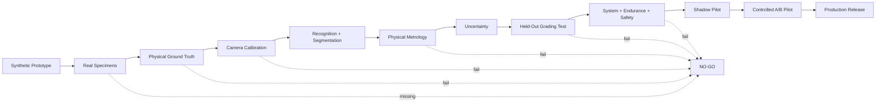
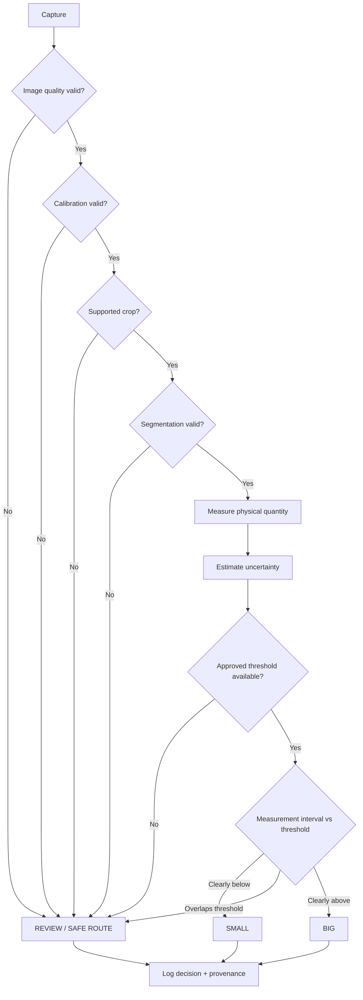

# Production-Grade Vegetable Grader Testing, Check-Gate, and Validation Master Plan

## Deliverable

The complete authoritative Markdown document has been created as a standalone **11,900+ word production-validation specification**:

**[Download `VEGETABLE_GRADER_PRODUCTION_TEST_VALIDATION_MASTER_PLAN.md`](sandbox:/mnt/data/VEGETABLE_GRADER_PRODUCTION_TEST_VALIDATION_MASTER_PLAN.md)**

It is designed specifically for the present state of the project: a vegetable-size grader whose current evidence originates substantially from **synthetic images**, but whose intended production output is a physically defensible `BIG / SMALL / REVIEW` decision for Indian vegetables and green vegetables.

The document treats the existing synthetic system as **NOT YET PRODUCTION VALIDATED**. That is deliberate. Simulation-to-real research explicitly describes a “reality gap”; synthetic/domain-randomized training can transfer useful representations to the physical world, but real-world testing is still necessary to establish actual deployment performance. citeturn19search1

I also incorporated and critically reconciled all four of the earlier project reports rather than copying their assumptions directly. fileciteturn0file0 fileciteturn0file1 fileciteturn0file2 fileciteturn0file3

## Research basis and critical corrections

The document uses a much stricter production philosophy than the prototype reports:

> **Recognition determines what vegetable is present. Segmentation determines its image boundary. Calibrated metrology determines its physical dimension. A version-controlled commodity rule determines BIG/SMALL. Measurement uncertainty determines when the system must say REVIEW.**

That decomposition is supported by real vegetable-measurement literature. Huynh, Tran, and Dao used a controlled single top-view camera with physical caliper, scale, and water-displacement references, while Zheng and colleagues used RGB plus stereo/depth and keypoints to estimate vegetable dimensions in physical space. The latter work also demonstrated that measurement performance changes with sensing distance and object geometry. citeturn19search2turn20search0

The plan explicitly rejects several dangerous prototype assumptions. It does **not** accept the earlier proposed bhindi/karela/lauki/chilli/etc. median values as official AGMARK or ICAR thresholds without a traceable primary source. APEDA provides an official entry point for AGMARK fruit-and-vegetable standards, and the AGMARK Online portal is operated by the Directorate of Marketing & Inspection under India’s Ministry of Agriculture & Farmers Welfare. ICAR has also documented DMI revisions of grading parameters based on multi-location analysis, showing why grading parameters need source/version control rather than being treated as permanent universal constants. citeturn13search2turn13search3turn13search0

A particularly important current standards finding is that the BIS catalog now lists **IS 15831:2026, “Power Operated Fruits & Vegetables Grader – Size Based – Specification and Test Code.”** The same BIS result distinguishes it from the older citrus-size grader standard, IS 15831:2009. The master plan therefore requires the organization to acquire and review the official standard text before claiming BIS compliance rather than inventing clause-level requirements from a search result. citeturn23search0

The plan also corrects any suggestion that printing one ArUco marker automatically makes a camera a precision measuring instrument. Zhang’s established calibration method estimates camera geometry from a planar pattern viewed in multiple orientations and explicitly models lens distortion. Current OpenCV 4.12 documentation recommends **ChArUco corners** instead of ordinary ArUco marker corners when higher calibration accuracy is needed. OpenCV also documents an incompatible board-coordinate convention change after version 4.6, which is why the test plan requires dependency pinning and geometry regression tests. citeturn14search0turn16search0turn16search1

## Production release doctrine

The master document establishes a strict gated path:

This mirrors an important lesson from industrial grading research: **vision performance, sorting-mechanism performance, and integrated system performance are different quantities**. In recent sweetpotato research, the machine-vision prototype and the later fully integrated pneumatic sorting system were evaluated separately, and the final integrated accuracy differed from subsystem performance; performance also varied with conveyor speed. citeturn20search2turn21search10

The same production-engineering principle appears in ICAR-CIAE’s official description of its Post-Harvest Equipment/Machinery Testing Centre: equipment evaluation follows BIS-based protocols and includes **no-load, load, and long-run testing**, with capacity, efficiency, energy use, losses, and output quality assessed. The validation document therefore requires a camera algorithm to survive not just an offline image test but a sustained full-system test when conveyor hardware is introduced. citeturn13search1

The corresponding deployed decision path is:

That makes `REVIEW` a genuine quality-control state, not a nuisance label.

## What the master document now covers

The Markdown file contains a full specification rather than a high-level checklist. Among other items, it includes:

| Validation area | What is specified |
|---|---|
| **Scope and assumptions** | Synthetic origin, supported/unsupported claims, physical-size definition, bounded deployment claims |
| **Indian standards** | AGMARK/DMI/APEDA source hierarchy, current BIS grader standard, threshold provenance requirements |
| **Hardware** | Camera, rigid mount, ChArUco target, fiducials, lighting, calipers, reference artifacts, scale, optional side/stereo camera, conveyor/encoder/actuator |
| **Dataset architecture** | Separate synthetic, real-recognition, real-metrology, and system/endurance datasets |
| **Dataset leakage prevention** | Physical-specimen-level splitting; farm/batch/day separation for harder generalization tests |
| **Ground truth** | Caliper SOP, flexible-tape/curved-length SOP, weighing-scale SOP, inter-operator repeatability protocol |
| **Calibration** | Intrinsic calibration, printed-board verification, physical artifact validation throughout ROI, recalibration triggers |
| **Segmentation** | IoU, Dice, boundary errors, endpoint errors, merge/split failures, and measurement-induced mask error |
| **Recognition** | Per-crop confusion matrix, unknown-crop rejection, false acceptance/rejection |
| **Metrology** | MAE, RMSE, bias, median absolute error, p95/p99 error, repeatability, intermediate precision |
| **Uncertainty** | Type A/Type B contributors, combined uncertainty, Monte Carlo option, threshold guard band |
| **Statistics** | Exact zero-failure binomial calculations, proportion precision, mean-error sample-size formula |
| **Unit tests** | Calibration, homography, geometry, skeleton, decision rule, invalid values, logging |
| **Integration tests** | Real artifacts, real produce, shadows, wet surfaces, overlap, threshold-adjacent items, multiple days |
| **System tests** | Held-out accuracy, unseen farms, throughput, latency, endurance, power loss, tracking, actuator timing |
| **Safety** | E-stop, guards, invalid-calibration fail-safe, tracking faults, actuator faults, stale-command prevention |
| **Field validation** | Shadow operation, paired A/B validation, controlled live rollout |
| **Monitoring** | Geometric drift, image drift, population drift, model drift, operational drift |
| **Operations** | Detailed daily and weekly check tables |
| **Logging** | Complete JSON decision-event schema with model/calibration/rule hashes |
| **Reproducibility** | Repository structure, command sequence, sample-size script, metric computation script |
| **Documentation** | Thirty-item release evidence package |
| **Sign-off** | Product, agricultural, metrology, ML/CV, software, mechanical, safety, operations and QA ownership |
| **Report templates** | Full validation report, daily check report, incident report |
| **Final release gate** | Thirty explicit `PASS/FAIL` production-release items |

The measurement-statistics design is grounded in formal metrology rather than arbitrary AI confidence. BIPM’s JCGM 100 provides general rules for evaluating and expressing measurement uncertainty; JCGM 101 covers Monte Carlo propagation through measurement models. NIST’s measurement-process guidance covers calibration, repeatability, reproducibility, stability, and uncertainty, while current ISO 5725 editions provide the trueness/precision and repeatability/reproducibility framework. citeturn18search0turn18search1turn17search10turn17search0turn17search4

## Statistical proof requirements

One of the most important additions is a rigorous answer to “How many vegetables do we have to test?”

For **zero observed failures**, the plan uses the exact one-sided binomial relationship:

\[
P(0\text{ failures}\mid p)=(1-p)^n
\]

and therefore:

\[
n\geq\frac{\ln(\alpha)}{\ln(1-p_0)}
\]

to support an upper error-rate bound \(p_0\) at confidence \(1-\alpha\).

The resulting table is built directly into the document:

| Maximum error rate to support | Independent zero-failure decisions at 95% confidence | At 99% confidence |
|---:|---:|---:|
| 5% | 59 | 90 |
| 2% | 149 | 228 |
| 1% | 299 | 459 |
| 0.5% | 598 | 919 |
| 0.1% | 2,995 | 4,603 |
| 0.05% | 5,990 | 9,209 |
| 0.01% | 29,956 | 46,050 |

This means, for example, that **100 correct accepted predictions do not prove 100% accuracy**. With zero failures in 100 independent accepted decisions, the one-sided 95% upper error bound is still approximately 3%.

The plan further prevents a common statistical mistake: taking 100 photographs of the **same potato** and calling that \(n=100\). Repeated captures are useful for repeatability, but the physical specimen is the independent unit for a specimen-population accuracy claim. This distinction follows the broader metrology requirement to characterize both repeatability and reproducibility rather than simply accumulating repeated measurements. citeturn17search0turn17search4turn17search10

It also requires class-specific evidence. A claim such as “false-BIG ≤0.1%” must be supported by sufficient **true-SMALL specimens**; a large pooled dataset dominated by BIG vegetables cannot establish the SMALL→BIG risk.

The file includes a runnable `sample_size.py` implementation for these calculations and a metrology metrics script computing specimen-level MAE, RMSE, bias, median absolute error, and p95/p99 absolute error.

## Safety, field release, and authoritative status

Once mechanical sorting is introduced, the grader becomes more than a computer-vision model. The document therefore separates AI grading from safety-related machine control. ISO 13849-1:2023 covers methodology for safety-related control-system parts, including software and electrical, hydraulic, pneumatic, and mechanical technology. ISO 12100 provides the machine risk-assessment/risk-reduction framework; as of October 2026, ISO lists the 2010 edition as under review with a successor draft in development, so the applicable edition must be rechecked at the time of machinery certification. citeturn22search0turn22search9

The final release rule in the document is intentionally uncompromising:

> **No synthetic accuracy, literature accuracy, simulated threshold, foundation-model confidence, or example code path can establish that this specific vegetable grader is production-ready. The deployed camera, calibration, physical vegetables, ground-truth instruments, grading specifications, software, uncertainty model, conveyor/actuator system, and field process must pass validation together.**

That position also aligns with the strongest evidence from the industrial literature. A 2024 sweetpotato vision prototype used rotating multi-view inspection and reported distinct performance for size measurement and final grading, while the integrated grader/sorter study separately measured vision grading and actual physical sorting. citeturn20search1turn21search10

The generated master plan is therefore suitable to serve as the project’s **authoritative QA/validation Markdown document**, while the remaining `[UNSPECIFIED]` values—most importantly target MAE, false-BIG/false-SMALL limits, minimum accepted accuracy, minimum coverage, target throughput, latency, supported crop/cultivar list, and exact commodity thresholds—are deliberately configured as **release blockers** rather than being filled with fabricated numbers.

**[Download the complete authoritative Markdown file](sandbox:/mnt/data/VEGETABLE_GRADER_PRODUCTION_TEST_VALIDATION_MASTER_PLAN.md)**